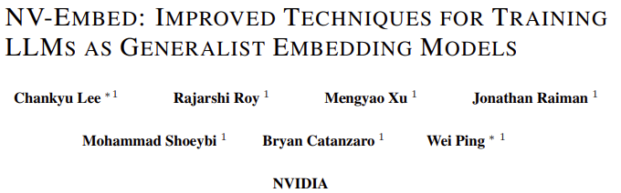

- huggingface
    - [https://huggingface.co/nvidia/NV-Embed-v1](https://huggingface.co/nvidia/NV-Embed-v1)
    - [https://huggingface.co/nvidia/NV-Embed-v2](https://huggingface.co/nvidia/NV-Embed-v2)

## 1.서론

- 디코더 전용 LLM이 프론티어 양방향 임베딩 모델보다 검색 및 일반 목적의 임베딩 작업에서 성능이 뛰어남
- NV-Embed의 기여점
    - Latent attention layer을 이용한 Pooling
        - 토큰 시퀀스에 대한 pooled embeddings 획득
        - pooling기술 통해 검색 및 다운스트림 정확도를 향상
        - decoder-only LLM의 contrastive training동안 causal attention mask를 제거하여 상당한 개선 획득
    - 2단계 contrastive instruction-tuning에 의한 모델 훈련
        - 사전학습된 Mistral-7B에 2단계의 contrastive instruction-tuning method를 사용함
        - 첫번째 단계에서 in-batch negative 와 curated hard-negative example들을 이용하여 검색용 데이터세트에 instruction으로 대조학습을 수행
        - 두번째 단계에서, curated 비검색 데이터세트를 첫번째 단계의 데이터세트에 혼합함.
            - in-batch negative sample들은 비검색 데이터세트에서 부작용을 유발하기 때문에 두번째 단계에서는 in-batch negative training을 비활성화함
            - 이와 같은 설계는 classification, clustering, STS, retrieval 성능을 크게 향상시킨다
            - 기존 존재하는 임베딩 모델을 파인튜닝하지 않음
                - 예를들어, SFR-Embedding과 Linq-Embed는 E5-mistral-7b-instruct에서 파인튜닝함
    - 데이터 큐레이션 레시피
        - 훈련데이터세트 큐레이션의 정확한 레시피와 함께 다음 사항을 제공한다
            - 데이터세트 관련 정보
            - 대조학습을 향상하기 위한 <positive-aware hard-negative mining> 기술
            - 합성데이터 생성
            - example기반 multi-class labeling
    - NV-Embed 성과요약
        - NV-Embed-v1 은 56개 임베딩 작업에 걸쳐 MTEB (Massive Text Embedding Benchmark)에서 1위 차지 (2024.05.24 기준)
        - NV-Embed-v2는 훈련데이터 큐레이션을 개선하여 72.31의 최고 신기록 수립. MTEB 리더보드 1위 (2024.08.30 기준)
        - 표1에 나와있듯이, 15개의 검색작업(BEIR), 11개 클러스터링 작업, MTEB벤치마크의 12개 분류작업에서 최고 기록 달성
        - Long Doc 부문에서 최고 점수 확보
        - MTEB에 미포함된 도메인 외부 정보 검색 범위를 다루는 AIR-Benchmark의 QA섹션에서 2번째로 높은 점수 달성
    - 모델 압축 기술 연구
        - 가지치기, 양자화, 지식증류를 포함한 모델 압축 기술 연구 수행
        - Llama3.2-3B, Qwen2.5-3B 및 Minitron-4B에 직접 구축, 비교

## 2.관련연구

- 양방향 임베딩 모델
    - BERT or T5 기반 임베딩 모델은 사전학습된 모델을 큐레이트된 비지도 학습 또는 약지도 텍스트 쌍을 사용하여 대조학습으로 추가 훈련
    - MS MARCO 포함한 다양한 지도학습 데이터로 미세조정
    - 사례) mxbai-embed-large-v1 (MTEB: 64.68), UAE-Large-V1 (64.64), voyage-large-2-instruct (68.28) 등
- Decoder-only LLM기반 Embedding 모델
    - 디코더 전용 LLM은 일반적인 임베딩 작업에서 양방향 모델보다 성능이 떨어진다고 여겨져 왔다. 그 이유는 다음과 같다
        - 단방향 어텐션은 표현학습 능력을 제한한다
        - LLM 규모가 커짐에 따라 임베딩 차원이 높아져서 차원의 저주 문제가 발생할 수 있다
    - Neelakantan et al (2022)의 연구
        - 디코더 전용 GPT-3 모델을 이용하여 임베딩 모델을 초기화하고 지속적인 대조학습을 적용. <EOS> 토큰에 해당하는 최종 레이어의 은닉상태가 입력 시퀀스의 임베딩으로 사용됨. 최신 후속 모델인 text-embedding-3-large는 MTEB 점수 64.59점을 달성
        - E5-Mistral은 Mistral 7B에 Task별 instruction으로 대조학습을 수행. MTEB 66.63점 달성하였으며, GPT-4모델에서 생성한 대규모 합성데이터를 활용하여 SOTA 양방향 모델의 성능을 뛰어넘음
    - SFR-Embedding-Mistral과 SFR-Embedding-2R
        - SFR-Embedding-Mistral (MTEB: 67.56), SFR-Embedding-2R (MTEB: 70.31)은 검색 및 비검색 데이터셋을 혼합하여 미세조정을 하여 정확도를 향상시킴. NV-Embed와 밀접히 관련되어 있으나 주요 차이점이 존재함
        - NV-Embed는 Mistral 7B LLM에 공개 데이터를 사용하여 scratch부터 훈련함. 다른 임베딩 모델이나 독점 합성데이터에 의존하지 않음. 불필요한 causal attention mask를 제거하고, latent attention layer를 갖는 sequence pooling mechanism을 향상 시킴
        - SFR-Embedding-Mistral은 동일한 Task에서 batch를 구성하는 반면, NV-Embed는 잠재적으로 지그재그식 기울기 업데이트를 방지하기 위해서 여러 task의 샘플로 구성된 잘 혼합된 batch들을 사용한다. 이는 SFR-Embedding-Mistral과 비교하여, 전체 MTEB및 검색작업 모두에서 최고 점수를 달성하도록 한다
- 데이터 큐레이션 개선
    - Gecko (MTEB:66.31)은 합성 쌍 데이터를 생성하도록 하여 디코더 전용 LLM모델에서 smaller bidirectional embedding model을 distill 한다
        - 각 query의 후보 passage를 검색
        - LLM을 사용하여 positive와 negative passage를 labeling 함으로써,
        - 데이터 품질을 정제한다
    - Linq-embed-mistral은  LLM을 활용하여 negative sample들을 생성, 필터링, 마이닝을 하여 data를 정제하였다.
    - NV-Retriever는 positive-aware hard-negative mining 기법을 소개함
        - false negative를 더욱 효율적으로 제거하기 위해서 positive relevance score를 고려함
        - 이 논문에서도 대조학습 향상하고 데이터 큐레이션을 위해 이 방법을 도입함

## 3.Method

3.1 bidirectional attention

- 단방향 attention은 모델의 표현력을 제한하여 BERT, T5보다 GPT모델의 성능이 좋지 않은 것으로 입증됨 (Wang et al., 2019)
- LLM2Vec (2024)은 특별히 설계된 masked token prediction으로 추가 훈련 단계를 도입
- GRIT (2024)는 양방향 표현 학습과 인과적 생성 훈련을 모두 포함하는 hybrid objective도입
- 본 연구는 간단히, causal attention mask를 제거함으로써 매우 효과적임을 발견함

3.2 Latent Attention Layer

- token sequence에 대한 임베딩을 얻는 2가지의 popular 방법과 이들의 문제점
    - 1) mean pooling, 2) 마지막 <EOS> token embedding
    - 이전의 양방향 임베딩 모델은 일반적으로 1)을 사용하는 반면,
    - 디코더 전용 LLM기반 임베딩 모델은 2)를 더 많이 사용한다
    - but, 두 방법 모두 특정 제한사항이 존재함
    - 1)은 단순히 토큰 임베딩의 평균을 취하므로 주요 구문의 중요한 정보를 희석시킬 수 있음
    - 2)는 recency bias(최근 편향)으로 인해 마지막 토큰의 출력 임베딩에 크게 의존할 수 있음
- 메커니즘
    - 별도의 공유메모리(latent array)에 시퀀스의 전역정보를 학습
    - Jaegle et al (2021)에 영감을 받았음
    - 디코더의 마지막 hidden layer를 Query로 표기
        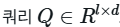
        - l은 시퀀스의 길이, d는 hidden dimension
    - Q는 latent array K, V와 어텐션을 수행하여, trainable dictionary가 더 좋은 representation을 얻도록 한다
        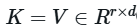
        - r = dictionary에서 latent의 개수
    - O는 cross-attention의 출력
        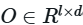
        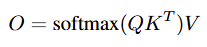
    - 2개의 선형변환과 사이에 GELU 활성화함수
        - latent attention layer의 r은 512
        - multi-head attention의 헤드 수 8
        - 전체 시퀀스의 임베딩을 얻기 위해 MLP 계층 후에 평균 풀링을 사용
        - Latent Array → ‘trainable dictionary’. r은 dictionary의 latent의 개수
            - 그림의 red matrix는 O에 해당
                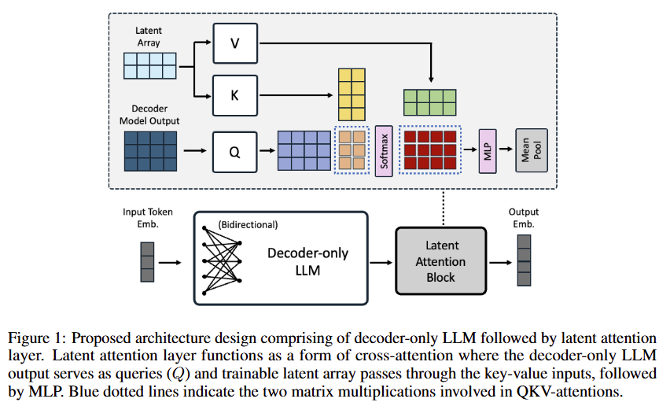

3.3 Two-Stage Instruction-Tuning

- 1단계)
    - 다양한 검색 데이터 세트에 대한 instruction을 사용하여 contrastive training을 수행하고, in-batch negative와 선별된 hard-negative 예제를 활용한다
- 2단계)
    - in-batch negative 트릭을 적용하지 않고, 검색 및 비-검색 데이터세트의 조합에 대해 contrastive instruction-tuning을 수행한다
- 검색작업이 다른 작업보다 더 큰 어려움에 있으므로, 처음에는 검색을 위한 모델 파인튜닝에 중점을 두고, 두번째 단계에서, 나머지 임베딩 task들을 instruction-tuning으로 혼합한다

## 4.Training Data

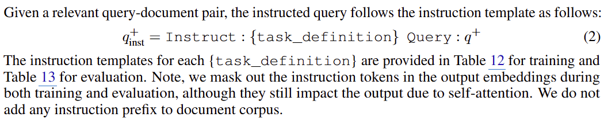

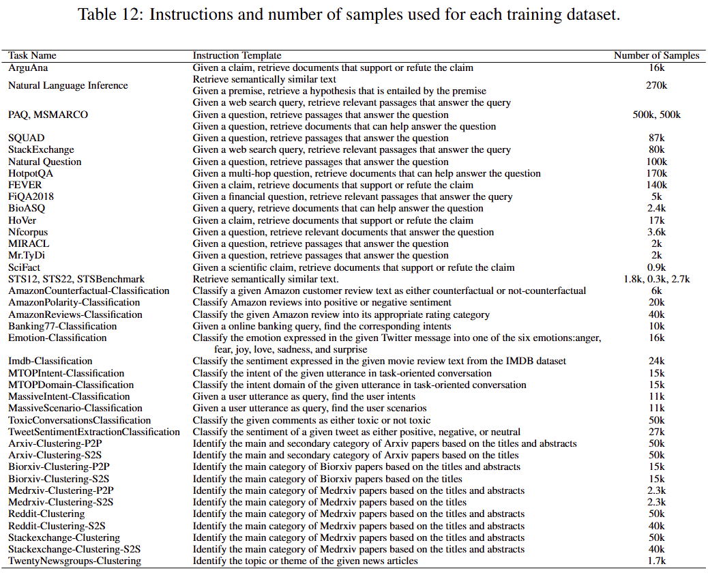

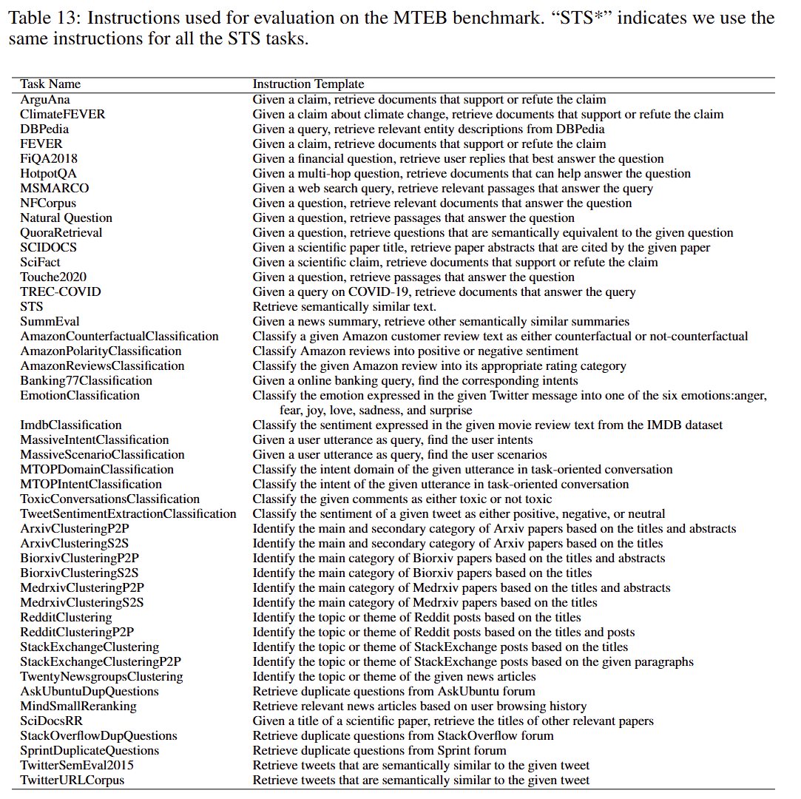

4.1. Public Retrieval Datasets

- Table 12에 훈련에 사용한 데이터세트별 샘플의 수가 있다

4.1.1 Hard Negative Mining Technique

- 임베딩 모델의 contrastive learning은, Query의 임베딩과 관련있는 passage의 유사성을 증가시키고, 관련없는 passage의 유사성을 감소시키는 훈련을 한다
- public retrieval dataset는 positive query-passage 쌍만 포함되어 있어서 negative example들을 마이닝할 필요가 있음
- Moreira et al (2024)의 positive-aware hard-negative 기법 참조
- Teacher 검색 모델로 E5-mistral-7b-instruct를 사용. query와 관련된 최적의 hardnegative passage를 식별
    - ? 95%의 마진으로 positive score의 비율에 기반하여 negative score의 maximum threshold 설정
    - max_negative_score_threshold = pos_score * percentage_margin

4.2 Public Non-Retrieval Datasets

- MTEB 벤치마크의 3가지 서브 태스크의 데이터를 활용한다. classification, clustering, STS
- 데이터셋은 contrastive training을 위한 검색 데이터셋과 호환되도록 데이터셋 포맷을 전처리함
    - query q^+
    - positive document d^+
    - hard negative documents {d0^-, …, dn^-}
- classification과 clustering 데이터셋
    - query q^+ 구축
        - 적절한 text/title/abstract 필드로부터 예제 text를 추출
- binary classification
    - d^+, d^-
- multi-class classification과 clustering
    - d^+
        - ground-truth class/cluster로부터 임의 추출
    - d^-
        - 나머지 class/cluster로부터 임의 추출
- STS (Semantic Textual Similarity)
    - (t_a, t_b, score) 쌍 구축
        - score가 4 이상인 경우,
            - (q^+ = t_a, d^+ = t_b )
            - (q^+ = t_b, d^+ = t_a )

4.3 합성데이터셋

- 모델
    - Mixtral-8x22B-Instruct-v0.1 모델을 사용
- 접근방법
    - E5-mistral-7b-instruct에서 제안한 2단계 프롬프팅 방식을 사용
- 프롬프트
    - 3가지 타입 : short-long, long-short, short-short
    - 각 타입별로 4만개씩 생성
- 결과물
    - 6만개 합성 Task에 12만개 합성 데이터로 구성
    - Appendix 15, 16에 합성데이터 생성용 예제 프롬프트이 있음
        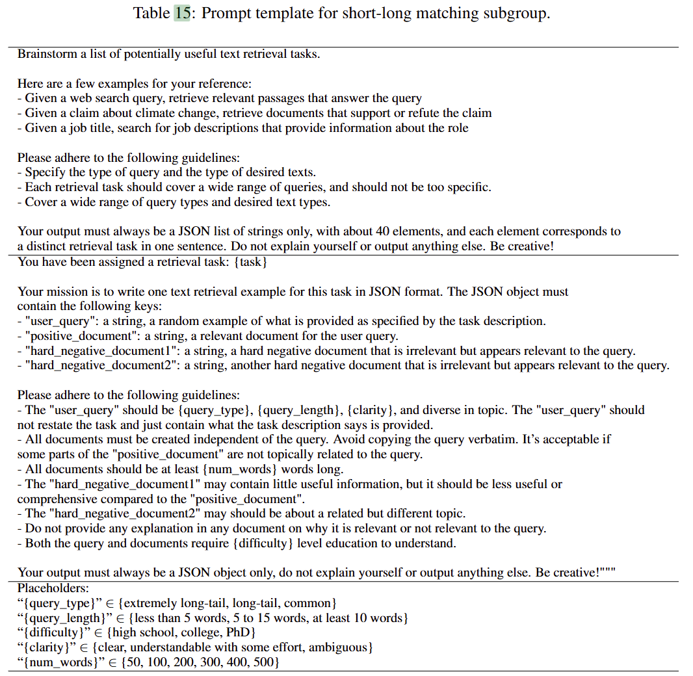
        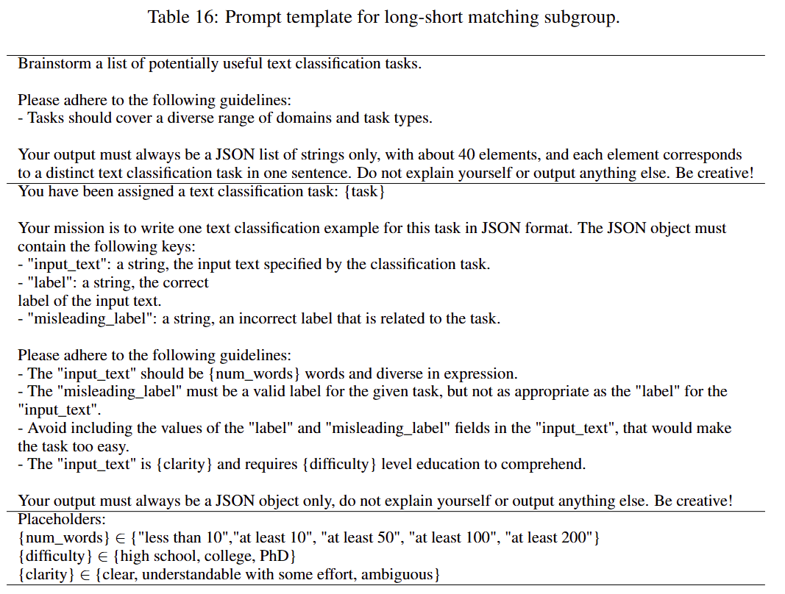

## 5.Experiments

5.1 MTEB Results

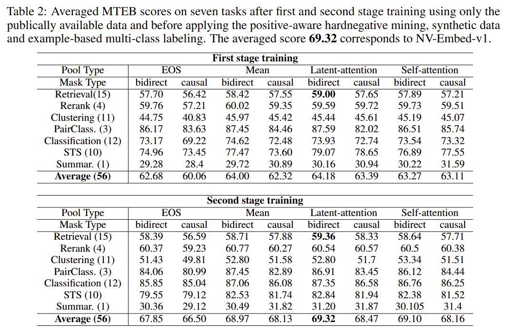

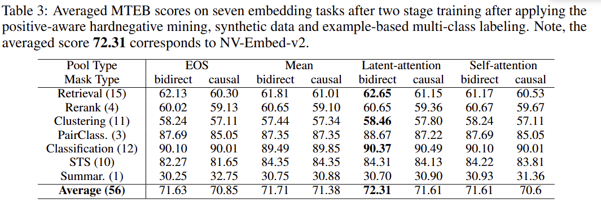

5.2 Ablation Study

5.2.1 Two-stage Training

- 첫번째 단계에서 검색 task 위한 in-batch-negative를 사용하고 두번째 단계에서 비-검색 task를 위해 in-batch 기술을 비활성화한다. 이렇게 함으로써 single-stage training성능을 능가한다
- in-batch-negative를. 도입하는 single-stable training은 MTEB 성능을 크게 저하시킨다. 특히, 분류 task에서.
    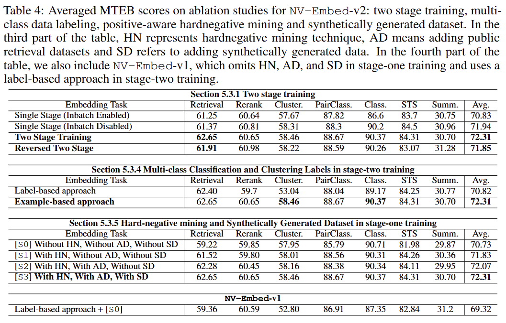

5.2.2 Causal Attention vs. Bidirectional Attention

- Table 2와 3에서 bidirection attention의 성능이 능가함을 보여줌

5.2.3 Pooling Methods

- <EOS>-last, mean, latent-attention, self-attention pooling types을 비교함
- mean pooling이 <EOS>-last token의 성능을 능가함
    - <EOS>-last token이 recency bias로 인함. 과도한 마지막 토큰에 의존
- self-attention 은 성능을 향상시키지 못함. 왜냐하면 이미 여러 계층에서 많이 사용함
- latent-attention은 대다수의 임베딩 task에 도움이 됨
    - dictionary learning은 더 많은 표현력을 향상시킴 → 시퀀스 전체의 전역적 특징을 학습
    - 출력 임베딩을 평균화함에 따른 정보 누락을 완화함

5.2.4 Multi-class Classification and Clustering Labels

- label-based approach
    - 쿼리 예제에 해당하는 ground-truth 클래스 label을 positive 문서로 구성
    - 다른 클래스 label을 negative문서로 샘플링하여 구성
- example-based approach
    - 쿼리 예제와 동일한 클래스의 다른 예제를 positive 문서로 구성
    - 다른 클래스의 예제를 negative 문서로 샘플링하여 구성
- Table 4에서 example기반이 label기반을 크게 앞선다
- Table 5는 상세한 Ablation Study
    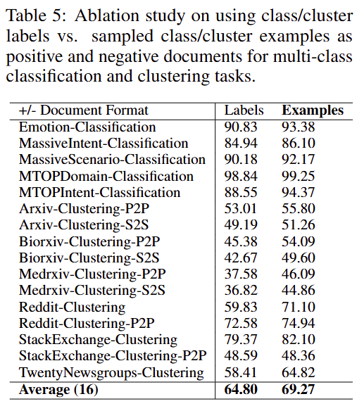

5.2.5 HardNegative Mining과 Synthetically Generated Dataset

- Table 4에 따르면, hard negative mining기법을 추가하는 첫번째 단계에서 검색 정확도를 상당히 향상 시켰음
- 각 기법별 적용 단계별로 소폭 성능이 향상됨을 보임

## A. Comprehensive Study of Model Compression Techniques for NV-Embed

A.1 Pruning

A.2 Knowledge Distillation

A.3 Quantization

## C. Experimental Details and Instruction Templates for Training and Evaluation

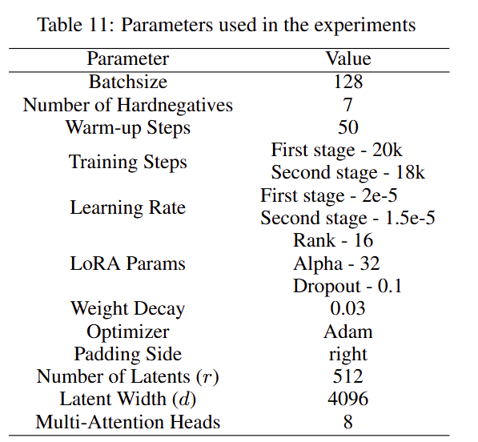

## D. Latent-Attention Visualization

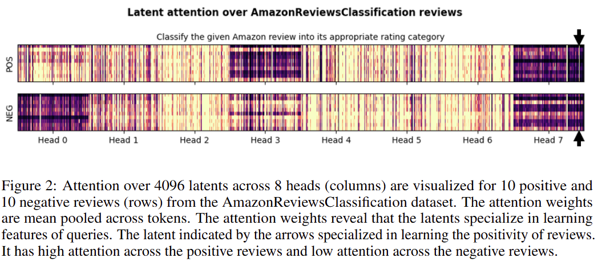
