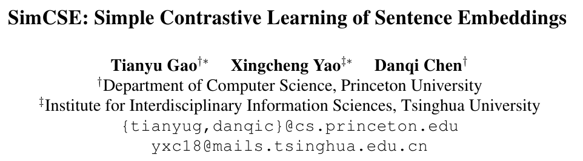

- github)
    - [https://github.com/princeton-nlp/SimCSE](https://github.com/princeton-nlp/SimCSE)
    - [https://github.com/dltmddbs100/SimCSE](https://github.com/dltmddbs100/SimCSE)
    - [https://github.com/BM-K/KoSimCSE-SKT](https://github.com/BM-K/KoSimCSE-SKT)
    - [https://github.com/hppRC/simple-simcse](https://github.com/hppRC/simple-simcse)

## 1. Introduction

- (a) 비지도학습기반은,
    - positive pair 얻기 : 사전학습 인코더에 입력을 2번 주입. 하나는 입력문장에 dropout을 noise로 적용
    - negatives 얻기 : 동일한 mini-batch내의 다른 문장들
- (b) 지도학습기반은,
    - NLI 데이터셋을 이용. entailment/neutral/contradiction
    - positive pair 얻기 : entailment
    - negatives 얻기 : contradiction
        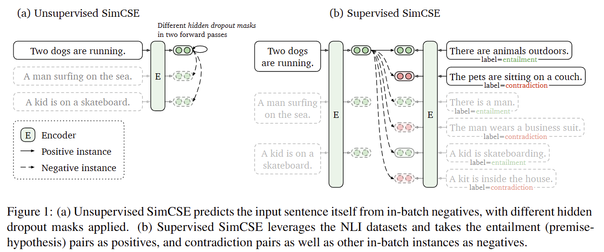

## 2.Background : Contrastive Learning

- 의미적 근접한 이웃은 가깝게
    - cross-entropy objective with in-batch negatives
    - 타우는 temperature. sim은 코사인 유사도
        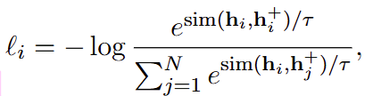
- Positive Instances
    - 기법1) 중간표현 + dropout
        - discrete operators(삭제, 대치, 치환 등)보다 성능이 좋았다
    - 기법2) dual-encoder기반
        - (x_i, x_i^+)가 서로 간에 성질이 구분될 때, 2개의 독립적인 인코더를 사용
        - 사례1) question-passage 쌍의 지도학습 데이터 세트 - Henderson (2017), Gillick (2019), Karpukhin (2020)
        - 사례2) 현재문장과 다음문장 - Logeswaran and Lee (2018)
- Alignment 와 Uniformity
    - embedding representation의 quality를 나타내는 지표 - by Wang and Isola (2020)
    - Alignment
        - positive 쌍들의 분포가 주어졌을 때, pairs간의 기대 거리
            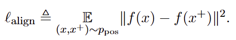
    - Uniformity
        - embeddings이 얼마나 잘 일관되게 분포되어 있는 지
            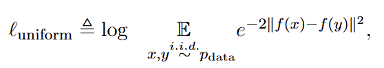

## 3.Unsupervised SimCSE

- 비지도학습 기반의 training objective
    - Dropout mask : encoder에 동일한 문장을 두번 입력하여 2개의 embedding을 얻는다
        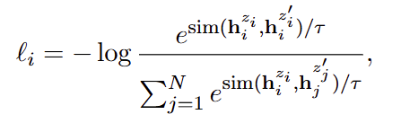
    - N은 mini-batch 크기
    - z는 standard dropout mask
- Dropout noise as data augmentation
    - Table 1 : data augmentation기법과의 비교
        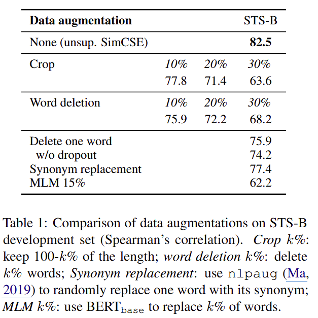
- Why does it work?
    - dropout rate을 다르게 했을 때의 성능변화
        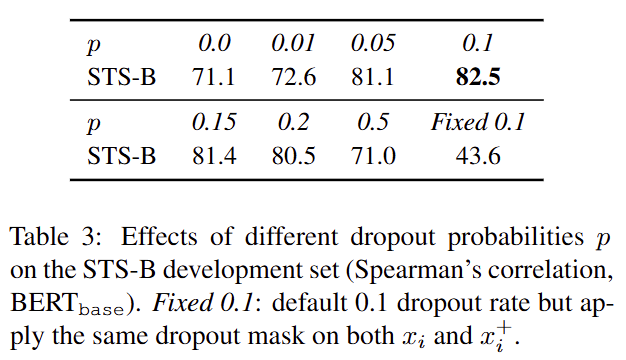
    - Pair의 embedding이 동일한 0.0과 Fixed 0.1의 경우, 성능이 많이 떨어진다
- alignment와 uniformity 실험
    - 학습이 진행될 수록 SimCSE방법 (dropout noise)은 안정된 alignment를 유지한다
        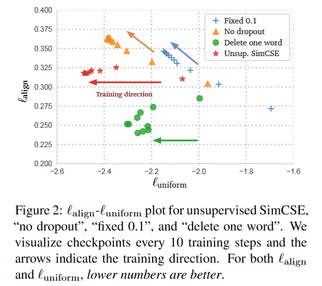

## 4.Supervised SimCSE

- NLI 데이터세트를 이용
- Contradiction as hard negatives
    - (x_i, x_i^+)을 (x_i, x_i^+, x_i^-)로 확장함
    - x_i 는 premise
    - x_i^+는 entailment
    - x_i^-는 contradiction
    - 지도학습기반의 training objective
        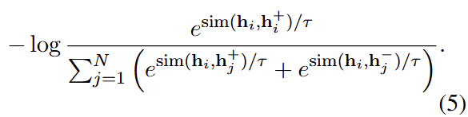
    - hard negative를 추가한 것이 더 나은 성능을 보임
        - 84.9 → 86.2
            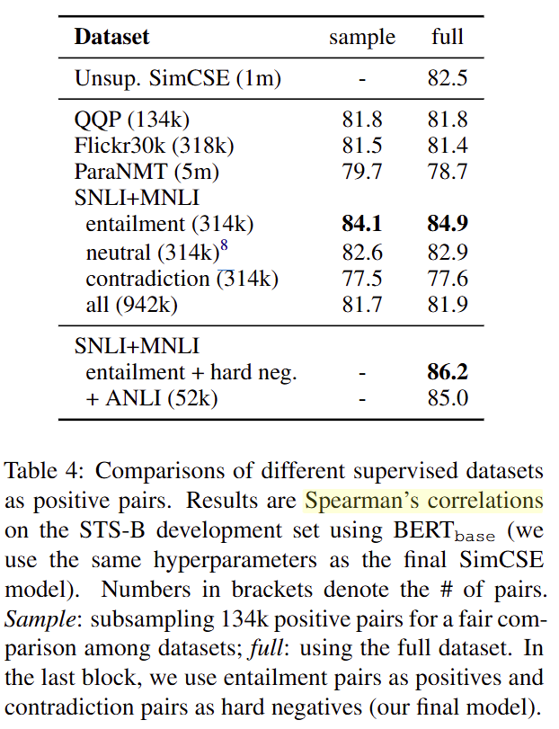
- Anisotropy problem (이방성 문제)
    - 임베딩 벡터들이 벡터 공간 상에 의미에 따라 균일하게 분포하는 것이 아니라, 모여있거나 특정 방향으로 편향되게 분포함
        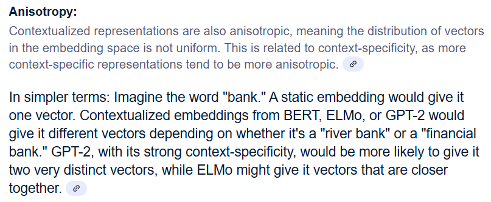
    - 참고) https://velog.io/@stapers/Contextual-Embedding-How-Contextual-are-Contextualized-Word-Representations

## 5. Connection to Anisotropy (이방성과의 연관성)

- Anisotropy를 완화하기 위한 시도들
    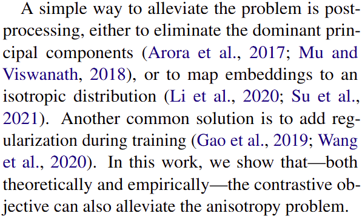
- contrastive learning objective는 negative instances를 서로 떨어뜨림으로 해서 uniformity가 향상될 수 있다
- 또한, 문장 임베딩의 특이값 분포를 평탄화(flatten)하고, 표현을 보다 등방성으로 만들 수 있음을 보여줌
- Wang and Isola (2020)의 다른 objective function
    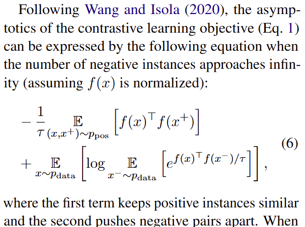
    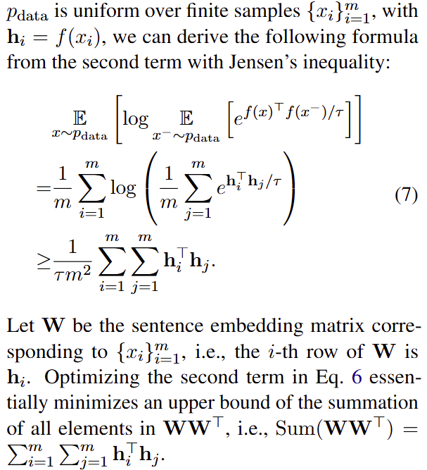
    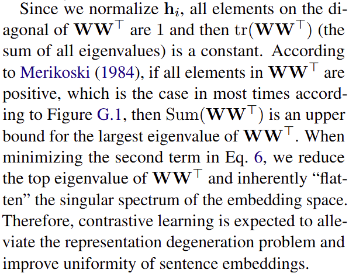

## 6. Experiment

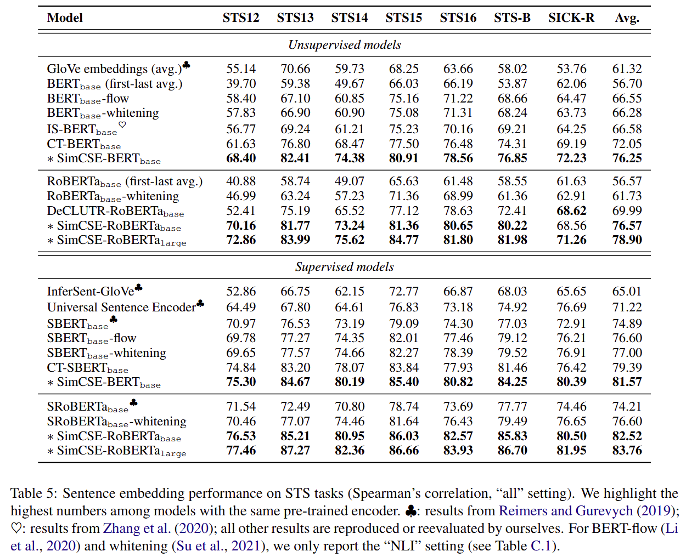

- Ablation Studies
    - Pooling methods
        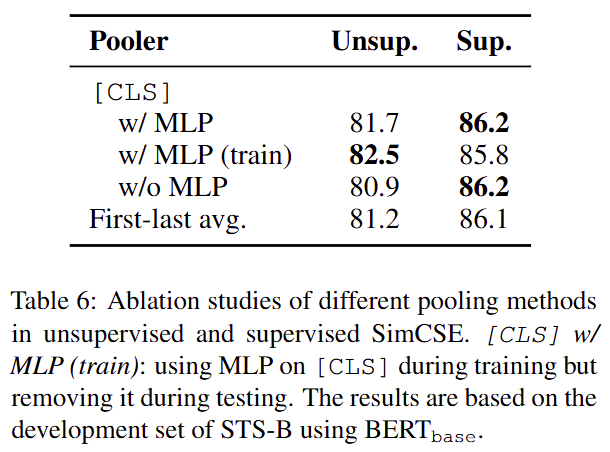
        - First-last avg : 사전학습 모델의 1st 계층과 last 계층의 average
        - BERT구현 위해 추가적인 MLP 계층을 구현함
            - [CLS]에 3가지 다른 셋팅
            - 1) MLP계층을 유지
            - 2) no MLP 계층
            - 3) 학습때에는 유지, 평가때에는 제거 → 비지도에서 최고성능
            - 지도 학습방법에서는 pooling method에 따라 성능 차이 없음
    - Hard negatives
        - 의미) 의미적으로 정답과 비슷하지만 정답은 아닌 문서
        - hard negatives와 다른 in-batch negatives 간에 구분을 두는 것이 도움이 될 수 있다
            - 식(5)
                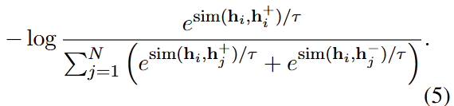
            - 식(5)를 확장
                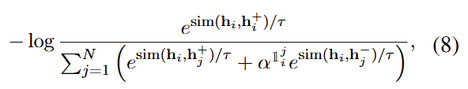
                - i==j 이면 (dropout mask처리된 자신 즉, hard negative)
                    - 알파^1로서 알파값을 여러값으로 실험함 (i≠j 이면, 알파값은 알파^0)
                    - 실험결과에 따르면 별다른 영향을 만들지는 않았음
                        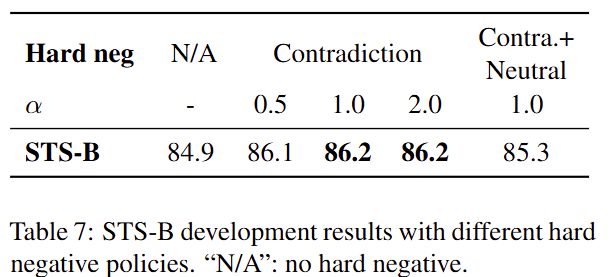

## 7. Analysis

- Uniformity and alignment
- Qualitative comparison
    - 대조학습을 통해서 훨씬 좋은 품질을 보임을 알 수 있다
        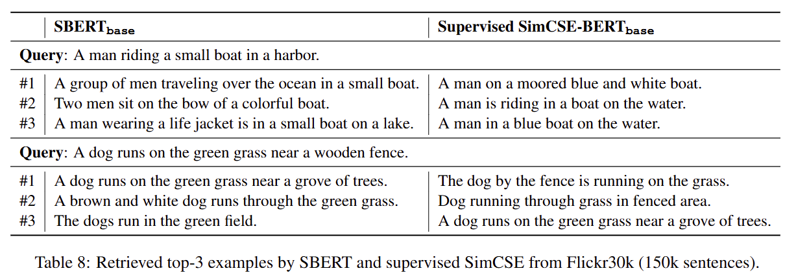
