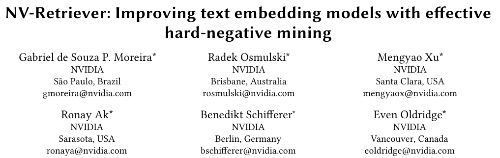
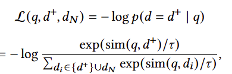
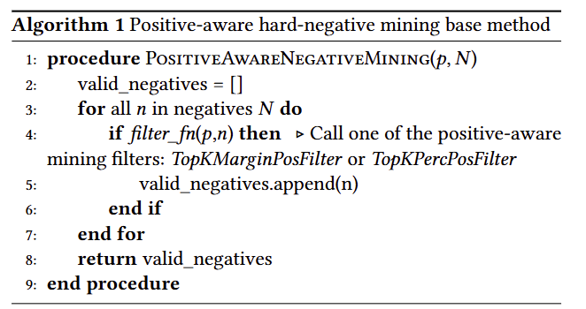
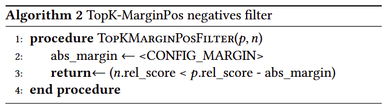
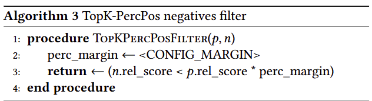
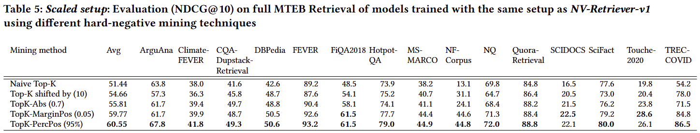
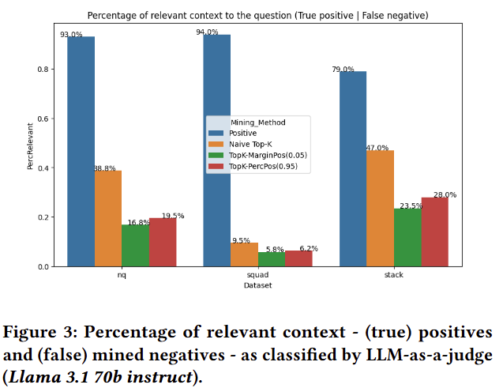
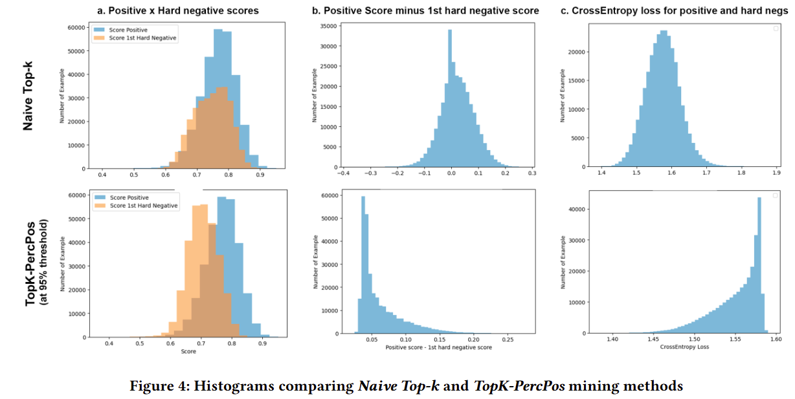

- github)
    - [https://github.com/nmixx-fin/nvretriever-test](https://github.com/nmixx-fin/nvretriever-test)
- Articles)
    - https://huggingface.co/blog/Albertmade/nvretriever-into-financial-text
- Keywords)
    - contrastive learning, hard-negative mining, positive-aware mining
- 기본 개념)
    - hard negative
        - 실제로는 negative인데, positive라고 잘못 예측하기 쉬운 데이터
        - negative sample이라고 말하기 어려운 sample → 정답과 유사하지만 정답이 아닌 sample
    - hard negative 문제의 원인
        - 클래스 불균형 문제
        - 학습 데이터는 주로 positive sample을 훈련
    - mini-batch Triples 구성방법
        - Triple (query, positive example, negative examples)
    - negative examples 마이닝
        - query와 근접한 벡터 공간상에 위치한 negative example들을 mining
- 본 논문은 대조학습의 성능 극대화 위해서, 위의 triple 데이터세트의 hard negative examples를 발굴하는 방법에 관한 것임

## 1.Introduction

- text embedding 관련 다른 연구들
    - E5, GTE, Jina
- 본 논문의 기여점
    - positive-aware hard-negative mining methods
        - 잠재적인 false negatives(오탐)를 제거하여 대조학습 성능을 향상하여 임베딩 성능을 개선
    - hard-negative mining의 Best Practices 연구
        - 다른 hard-negative mining 기법들을 비교
        - hard-negative mining기법의 선택에 따라 retrieval model이 얼마나 sensitive한지 보여줌
    - Text Retrieval의 SOTA 달성위해 mining method를 확장
        - 제안한 방법을 확장하여 MTEB Retrieval leaderboard에서 1위 달성. 2024. 7월 11일

## 2.Background

2.1. Text embedding models

- E5 model family는 2단계 학습을 한다
    - 1st 단계 학습은 비지도 텍스트 쌍으로 사전학습. 예) neighboring text spans, title-abstract
    - 2nd 단계 학습은 지도 학습데이터로 미세조정. 예) qa, text-summary, search-relevant passages
    - E5는 labeled data를 사용하지 않고 BEIR에서 BM25 성능을 앞질렀음
- E5-Mistral 임베딩 모델은 decoder 모델을 base모델로 사용함
    - Mistral-7B를 사용
    - LLM이 생성한 합성데이터와 소량의 레이블 데이터를 사용하여 단일 라운드로 fine-tuning
- BEIR 벤치마크
    - 18개 retrieval datasets로 zero-shot 텍스트 검색에 대한 standard evaluation 제공
    - 이후,  MTEB는 보다 포괄적인 text embedding 벤치마크가 됨
        - 영어권 7 tasks (retrieval, reranking, classification, clustering, pair classification, summarization, semantic textual similarity)에 대해 56개의 datasets
        - MTEB의 retrieval task는 BEIR로부터 15개 datasets로 구성됨

2.2 hard-negative mining for fine-tuning embedding models

- CL (contrastive learning)은 triple이 필요 (query, positive passage, negative passages)
- <샘플링 기법> negative passage 샘플링 방법
    1. in-batch negatives
        1. 배치 내에 있는 다른 example들을 사용
        2. 장점) forward pass로 이미 이들 embedding이 계산되어 있기 때문에 연산 효율적임
    2. past-batches
        1. 메모리에 저장 후 사용
        2. batch size제한 문제를 완화
    3. cross-batch
        1. 다른 GPU의 batch들을 사용
        2. batch size제한 문제를 완화
- negative 샘플들의 특징
    - in-batch ‘random’ negative 샘플
        - query와 관련없이 무작위 sampled되기 때문에 loss 및 gradient 값이 낮고 model 수렴에 거의 기여하지 않기 때문에 CL에 유용하지 않음 (→ 원래부터 벡터간 거리차가 크기 때문에 조정이 불필요)
    - hard negative 샘플
        - gradient norm의 상한을 높이고, 확률적 gradient 추정의 분산을 줄이며, 학습속도를 높인다
- <검색 기법> in-batch이외의 hard-negative mining 기법
    - sparse 또는 dense 검색모델을 사용
    - positive로 label되지 않은 query와 유사하고 BM25로 계산된 1~2개의 example들을 사용
- <점진적 기법> incremental hard-negative mining 기법
    - 이들 기법은 구현이 복잡하고, 대규모 말뭉치 계산에 많은 비용이 소요됨
    - 따라서, 대부분의 MTEB상위모델들은 미리 학습전에 사전학습모델 사용하여 마이닝을 함
    - 1) ANCE - (비동기적 index 갱신)
        - 갱신된 passage embedding으로 index를 비동기적 갱신함
        - 그리고나서, query별로 hard-negative를 mining함
    - 2) NGAME - (클러스터링 수행)
        - query와 positive 임베딩을 클러스터링 수행
        - 이들 클러스터 사용하여 negative mining을 고려한 mini-batch를 준비
- False negatives 제거하기
    - naive한 hard-negative mining은 많은 false negatives들이 선택될 수 있다
        1. Filtering
            - query와의 relevance score로 높은 score를 제거하여 필터링할 것을 제안
        2. cross-encoder모델로 denoise (RocketQA)
        3. 더 강력한 decoder LLM으로 denoise
    - 서로 다른 negative score 임계값 연구
        - ablation 연구 (0.4, 0.5, 0.8) (in 사전학습모델 snowflake-arctic-embed-I )
    - top-k 후보 범위내 샘플링
        - ablation 연구 (0-100, 30-100, 50-100) (in 임베딩 모델 SFR-Embedding-Mistral )
        - 30-100범위가 false negative 제거에 도움이 된다고 함
    - powerful한 모델을 사용하는 것이 mining에 도움이 된다고 함

## 3.Methodology

3.1 Positive-aware hard-negative mining methods

- retrieval model을 위한 popular contrastive learning loss
    - InfoNCE
        
- False negative 필터링 기법
    1. Top-K shifted by N
        - N=5라면, 상위 5개 negative를 ignore한다
        - 상위 5개부터 15개 사이의 negative를 고려한다
        - 한계) negative relevance score를 고려하지 않음
    2. Top-K with absolute threshold (TopK-Abs)
        - negative score의 지정한 임계값 보다 높은 negative들을 ignore
        - 한계) positive relevance score를 고려하지 않음
- 본 논문 제안
    
    1. Top-k with margin to positive threshold (TopK-MarginPos)
        1. maximum negative threshold = positive score - absolute margin
            
    2. Top-k with percentage to positive threshold (TopK-PercPos)
        1. maximum negative threshold = positive score의 percentage
            

3.2 Research Questions

- 여러 개의 teacher model을 사용하여 마이닝하는 것에 대한 내용임
- RQ1. 서로 다른 teacher model로 마이닝하는 것은 다운스트림 정확도에 얼마나 많은 영향을 미치나?
- RQ2. 서로 다른 teacher model로 마이닝한 hard-negative들을 ensemble하면 결과를 향상시킬 수 있나?
- RQ3. 서로 다른 hard-negative mining method들의 정확도 비교
    

## 4.Experiment results and discussion

4.1 RQ1. Using different teacher models for mining

4.2 RQ2. Ensembling hard-negatives from different teacher models

4.3 RQ3a. Comparing methods for mining hard-negatives

4.4 RQ3b. Comparing mining methods at scale with NV-Retriever-v1

4.5 positive-aware negative mining의 효과

4.5.1 False negative removal

- Figure 3은 각 method의 오탐율을 나타냄  (relevant (false) negatives의 percentage)
    - LLM-as-a-judge (Llama 3.1 70b instruct)를 사용하여, train set의 sample들이 question에 relevant한지를 분류하는 프롬프트를 사용함
    - Positive bar는 reference로서, true positive의 비율임. (question과 passage가 LLM이 93%, 94%, 79%등이 relevant하다고 판단한 것임)
    - 나머지 bar들은 각 mining 방법들이 true positive를 잘못 분류하는 비율을 나타냄. 따라서 percentage가 적을 수록 오탐율이 적은 것임
        

4.5.2 Visualizing the effect of positive-aware mining

- a) Score 분포간 차이
    - Naive Top-k : 두 군집의 분포가 겹쳐 있음
    - TopK-PercPos : Score의 평균값 차이가 있음
- b) Positive score - 1st hard negative score
    - Naive Top-k : 0.0 주변에 몰려 있음. Positive와 Negative 간 score차이가 별로 없다
    - TopK-PercPos : 대부분 양의 값으로 0.05주변에 몰려 있음
- c) Loss 값의 분포
    - Naive Top-k : Loss 값 범위의 제한이 없음
    - TopK-PercPos : Loss 값의 limit가 제한되어 stable training을 보임
        
