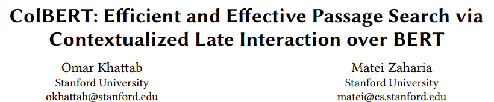

- github)
    - [https://github.com/stanford-futuredata/ColBERT](https://github.com/stanford-futuredata/ColBERT)
    - [https://github.com/movie112/ColBERTforKorean](https://github.com/movie112/ColBERTforKorean)
- 1.서론
    - 문제점
        - single relevance score 계산을 위해 대규모의 쿼리-문서 쌍을 신경망에 입력해야 하는 많은 비용 소요
    - 논문의 의의
        - Multi-vector embedding
            - **단어 순서**와 **정확한 구문 일치**가 중요한 검색 작업에 유용한 기법
            - 연산량과 메모리 자원이 많이 소요됨 → 필요한 곳에 전략적으로 사용해야 함
            - 제품사례)https://docs.weaviate.io/weaviate/tutorials/multi-vector-embeddings
                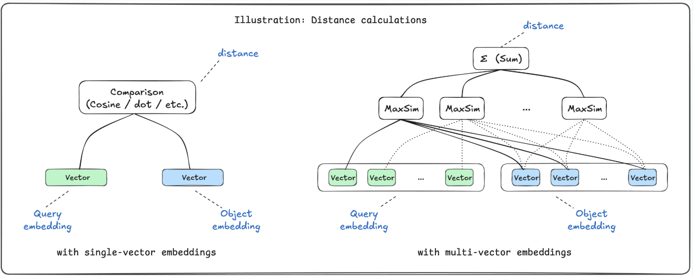
        - late interaction (후기 상호작용) 아키텍처
            - Q와 D를 함께 입력할 필요가 없음
    - 실험결과
        - 다른 BERT기반 모델과 경쟁할 만한 품질이며, BERT를 쓰지 않는 기준 모델보다 뛰어남
        - 쿼리당 약 100배(10^2) 빠르게 실행
        - 약 1만 배(10^4) 더 적은 FLOPs를 필요로 함
- 2. Related Work
    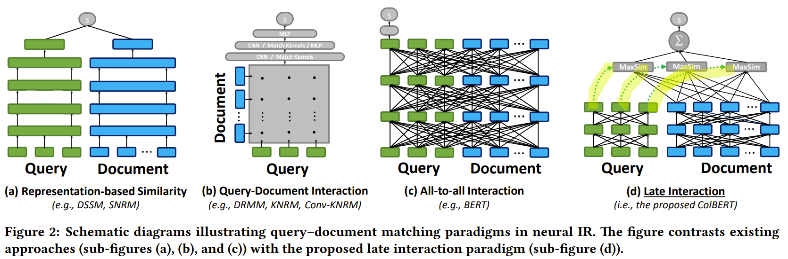
    - b, c) 많은 시간 소요
        - GPU로 Transferring시간 : 매우 큰 document 컬렉션
        - 매우 많은 pairs of (q, d) 간 attention 비용
    - d) Late Interaction의 장점
        - 저렴한 q, d간 상호작용
        - top-k 검색 통한 효율적인 가지치기
- 3. COLBERT
    - 3.1 Architecture
        - 1) 쿼리 인코더 , 2) 문서 인코더, 3) Late Interaction 메커니즘으로 구성됨
            - 각 인코더는 서로 다른 문맥하에 임베딩 수행
        - 1) 쿼리 인코더
            - a bag of fixed-size embeddings E_q
        - 2) 문서 인코더
            - a bag of fixed-size embeddings E_d
        - 3) Late Interaction (후기 상호작용)
            - MaxSim 연산자
                - t_q와 t_d 사이 가장 큰 유사성 점수를 계산
            - score
                - 개별 MaxSim 점수를 합산
                    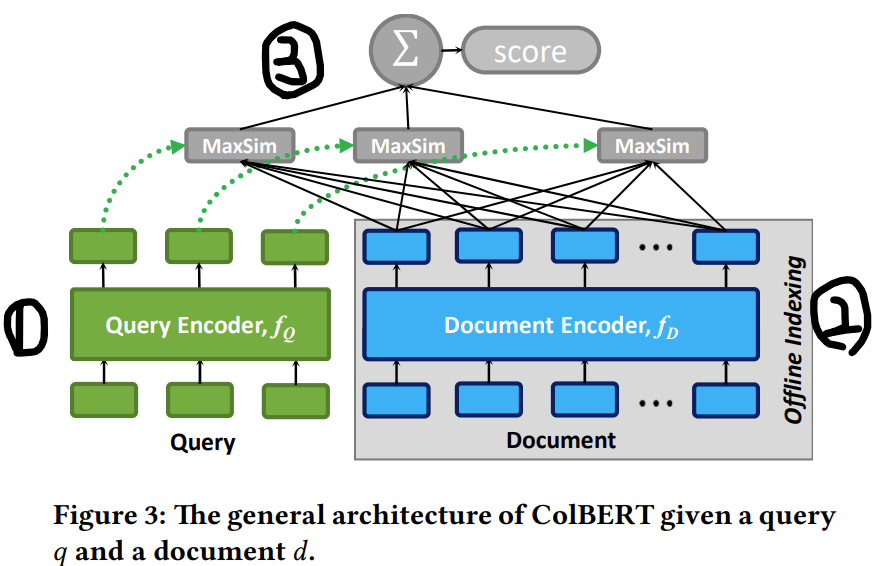
    - 3.2 Query & Document Encoders
        - Query Encoder
            - BERT기반의 WordPiece토큰으로 분할
            - 시작토큰 [CLS] 다음에 [Q] 토큰으로 시작
            - 길이가 짧은 질의문은 뒤에 [mask]토큰으로 Padding
            - 길이가 긴 질의문은 기정의된 길이로 절삭
        - Document Encoder
            - BERT의 시작토큰 [CLS] 다음에 [D] 토큰으로 시작
            - [mask]토큰을 사용하지 않음
            - punctuation symbol들을 제거
        - Summary
            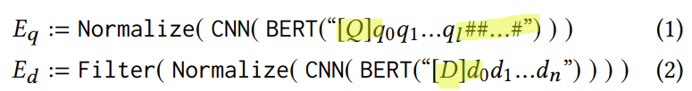
    - 3.3 Late Interaction
        - S_q,d = d와 q 간 relevance score
        - a sum of maximum similarity 계산
            1. cosine 유사도
                1. 정반대 (-1), 무관 (0;직교), 동일 (1)
                    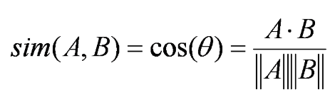
            2. squared L2 distance
                1. 유클리드 거리 (0에 가까울 수록 유사)
                    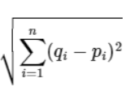
    - 3.4 Offline Indexing : Computing & Storing Document Embeddings
        - 여러 개의 문서를 병렬로 인덱싱
        - BucketIterator Library
            - Length-based bucketing
            - 길이 순으로 정렬 후, batch크기만큼의 문서 그룹끼리 Encoding수행
        - 문서 representation 저장
            - 각 차원을 32-bit or 16-bit 값으로 나타냄
    - 3.5 Top-k Re-ranking with ColBERT
        - 기존 방식은 l = |q| + |d|을 bert에 주입하여 attention 비용이 크다
        - 본 방식은, late interaction에 의해, 쿼리 타임에  l=|q| 만 bert에 주입하기 때문에 훨씬 비용이 적음
    - 3.6 End-to-end Top-k Retrieval with ColBERT
        - 1단계) 대규모 문서 컬렉션의 색인
            - faiss 색인
            - IVFPQ index
                - inverted file with product quantization
                - k-means 색인 수행
                    - embedding space를 P개의 cell로 분할
                    - 각 document를 가장 가까운 cell에 할당
                - query주어지면,
                    - 가장 가까운 partition k를 먼저 검색후 찾는다
                - 이때, 양자화된 임베딩 표현 사용
                    - 모든 embedding은 s개의 sub-vector로 분할
                    - 각 sub-vector는 one-byte로 표현
        - 2단계) top-k 검색
            - 필터링 역할
            - faiss 검색
        - 3단계) top-k에 대해서 re-ranking
            - 3.5에서 설명된 내용 수행
- 4. Experimental Evaluation
    - 4.1 Methodology
        - MS MARCO
            - 웹페이지 880만개의 passage모음 (Bing 검색결과 100만개의 실제 쿼리로부터 수집)
        - TREC CAR
            - wikipedia기반 합성데이터로 구성된 약 2,900만개의 Passage모음
    - 4.2 Quality-Cost Tradeoff : Top-k Re-ranking
        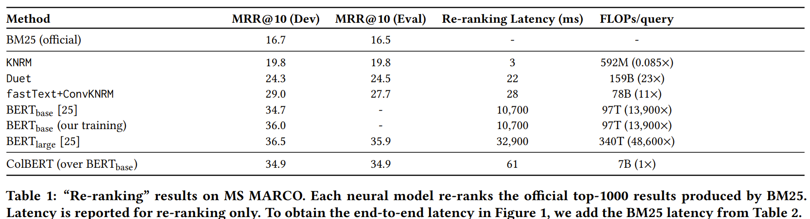
        - MRR (Mean Reciprocal Rank)
            - 처음 등장하는 선호 아이템이 몇 번째에 위치하는 지
            - 역수를 취해서 계산
    - 4.3 End-to-end Top-k Retrieval
        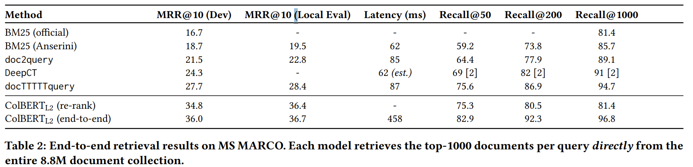
    - 4.4 Ablation Studies
        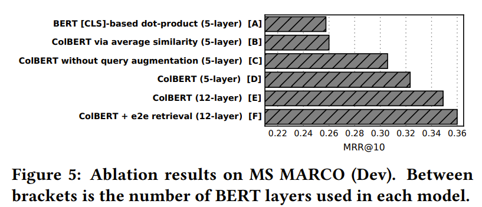
    - 4.5 Indexing Throughput & Footprint
        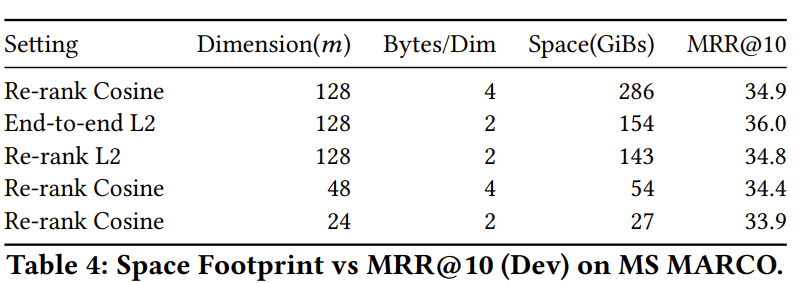
- 5. Conclusions
    - 기존 BERT기반 모델보다 170배 빠르고 쿼리당 14,000배의 더적은 FLOPs 소요
