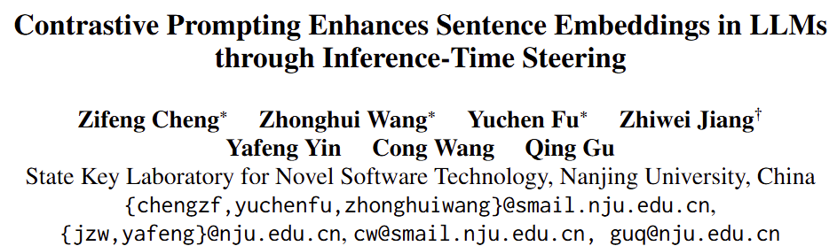

- 동기
    - 기존 방식의 LLM의 문장 임베딩은 마지막 토큰의 임베딩 값에 과도한 비-필수 정보가 인코딩되는 문제가 존재함
- 요약
    1. 대조 프롬프팅 (Contrastive Prompting, CP) 제안
        - 일반 프롬프트 이외에 보조 프롬프트 도입
        - 보조 프롬프트는 불필요한 정보를 요청하는 프롬프트
        - 추론 시점에 순전파 활성화 값 차이를 비교
    2. 추론시점 활성화 조정 (Inference-Time Steering)
        1. Activation Steering 기술
        2. LLM의 출력을 수정하는 steering vector를 사용
        3. positive 와 negative samples의 차이를 학습
- 개념도
    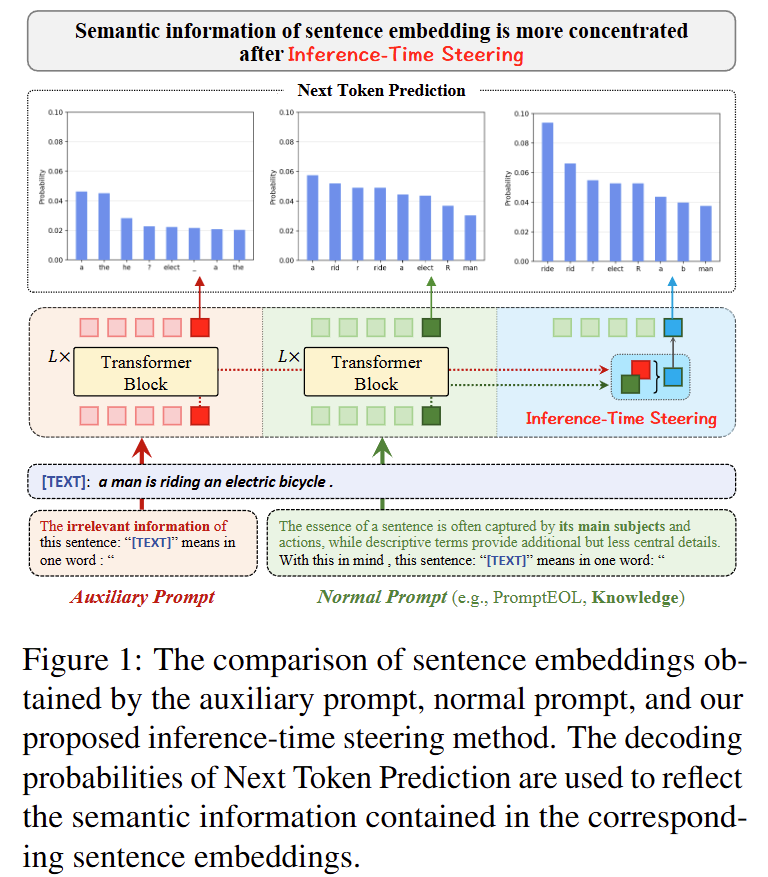
- Auxiliary Prompt
    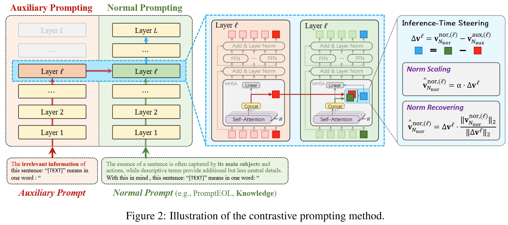
- 1단계) Contrastive Activation Steering
    - Normal Prompt의 입력 시퀀스
        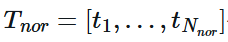
    - Auxiliary Prompt의 입력 시퀀스
        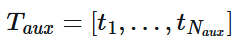
    - LLM에 주입하여 forward propagation 수행
    - Transformer의 L번째 계층의 MHA으로부터 contextualized value vector 얻기
        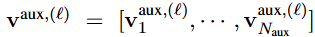
    - Transformer의 L번째 계층의 MHA으로부터 contextualized value vector 얻기
        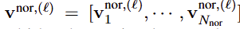
    - Activation Steering Vector얻기
        - 문장별 마지막 토큰 값만 사용
            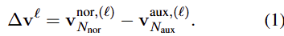
- 2단계) Norm Adjustment
    1. Norm Scaling (NS)
        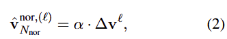
        - 알파: activation 값의 scale을 조정하는 하이퍼파라미터
    2. Norm Recovering (NR)
        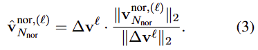
        - 후속 출력 matrix가 안정적인 입력을 받도록 L2 정규화 수행
- 최종결과) Final Activation Vector
    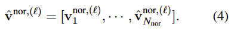
- 성능
    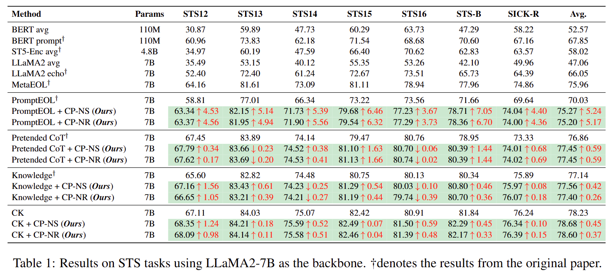
- 보조 프롬프트 실험
    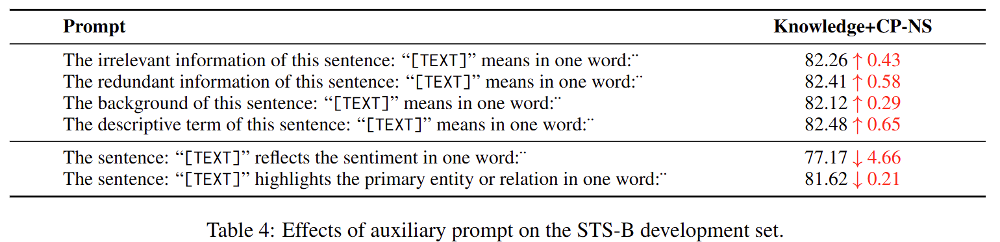
