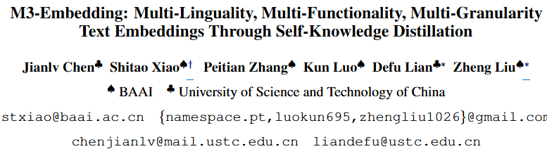

- github
    - [https://huggingface.co/BAAI/bge-m3](https://huggingface.co/BAAI/bge-m3)
    - [https://github.com/FlagOpen/FlagEmbedding](https://github.com/FlagOpen/FlagEmbedding)
- huggingface
    - [https://huggingface.co/BAAI/bge-m3-retromae](https://huggingface.co/BAAI/bge-m3-retromae)
- article
    - [https://zilliz.com/learn/bge-m3-and-splade-two-machine-learning-models-for-generating-sparse-embeddings](https://zilliz.com/learn/bge-m3-and-splade-two-machine-learning-models-for-generating-sparse-embeddings)
- 요약
    - Multi-Linguality : 100개 이상의 언어에 대한 시맨틱 검색 지원
    - Multi-Granularity : 다양한 Granularity의 입력 처리 (짧은 문장 부터 8,192개 토큰의 긴 문서까지)
    - Multi-Functionality : 3가지 검색 (dense retrieval, sparse retrieval, multi-vector retrieval)을 동시 수행 가능 하며 이들 검색기능의 관련성 점수를 통합하여 학습 품질 향상
- 개념도
    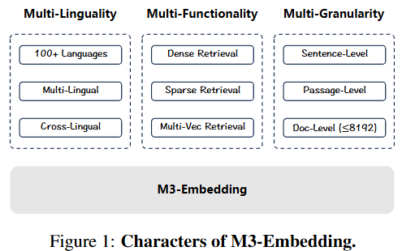
- 대표도
    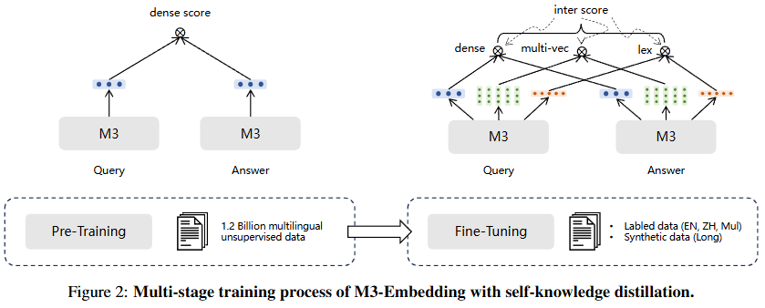
- Text Encoder
    - XLM-RoBERTa (2020)
- M3-Embedding의 문서검색
    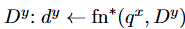
    - 쿼리 = q^x
    - 문서 = D^y
    - 함수 f_n^* = dense, lexical 또는 multi-vector retrieval함수 중의 하나
    - x와 y는 임의의 언어로서, 동일 언어 또는 다른 언어
- 3가지 Retrieval 기법
    1. Dense Retrieval
        1. Query q와 Passage p
        2. H_q = Query의 토큰 시퀀스의 특수 토큰 ‘[CLS]’의 Hidden State
            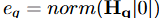
            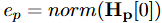
        3. **score s_dense** : 임베딩 간 내적 계산
            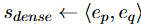
    2. Lexical Retrieval (Sparse)
        1. 용어 Weight계산
            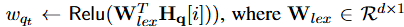
        2. W_lex : Hidden state 를 float 단일값 매핑 행렬
        3. **score s_lex** : Query와 Passage에 co-exist하는 용어의 가중치 합
            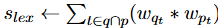
    3. Multi-vector Retrieval
        1. Query와 Passage의 모든 Hidden States를 사용 → E_q ( Lq x d ), E_p ( Lp x d )
            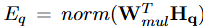
            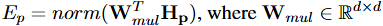
        2. **score s_mul**
            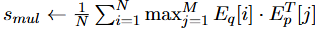
            - N : Query의 길이
            - M : Passage의 길이
- Reranking 기법
    - 3가지 Retrieval 기법을 개별로 수행하여 Candidates를 추출
    - 통합 relevance score 계산
        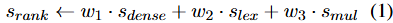
        - w1,2,3은 다운스트림 시나리오에 따라 다르게 설정할 수 있음
- 개별 임베딩 학습
    - 데이터셋 : Positive Samples (p^*) , Negative Samples (p^’)
    - s(.)함수 : s_dense, s_lex, s_mul 중의 하나
    - InfoNCE loss
        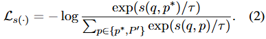
        - https://velog.io/@hsbc/InfoNCE-Information-Noise-Contrastive-Estimation
            - 대조학습에 많이 이용되는 손실함수
            - Positive Sample간의 유사도는 최대로, Negative Sample과의 유사도는 최소가 되도록
- 통합 임베딩 학습-1 (self-knowledge distillation 없는)
    - 서로 다른 성질(heterogeneous)의 score를 통합하기 위한 앙상블 기법
    - s_inter (통합 스코어) : 개별 score들의 가중합
        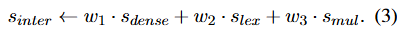
    - L (통합 Loss) : 개별 loss들의 가중합
        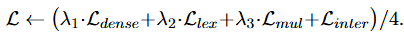
- 통합 임베딩 학습-2 (self-knowledge distillation 기반)
    - s_inter : teacher (XLM-RoBERTa)
    - s_* : 개별 score
    - CrossEntropy loss
        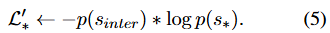
        - https://velog.io/@cha-suyeon/%EC%86%90%EC%8B%A4%ED%95%A8%EC%88%98loss-function-Cross-Entropy-Loss
        - 두 score의 분포 사이의 entropy값이 최소가 되도록
    - L (통합 Loss) : 개별 knowledge distillation loss의 가중합
        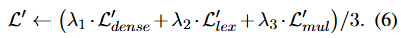
- Final Loss계산
    - Linear combination
        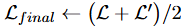
- 실험1
    - 데이터셋
        - MIRACL 다국어 검색 평가셋 : 18개 언어
    - 평가지표
        - nDCG@10 : 정보검색평가 위한 순위 평가 지표
            - 순위가 높을 수록 더 큰 가중치 부여
            - 사용자가 빠르게 필요한 정보를 얻는데 초점을 맞춘 평가 지표
                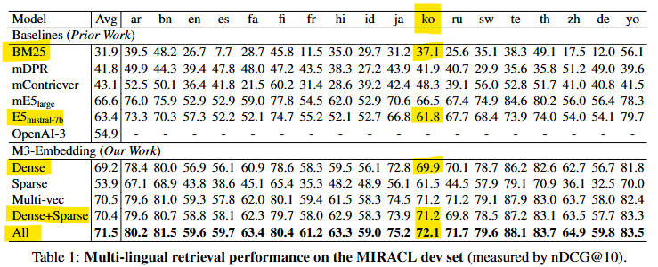
- 실험2
    - 데이터셋
        - MLDR (Multilingual Long-Doc Retrieval)
            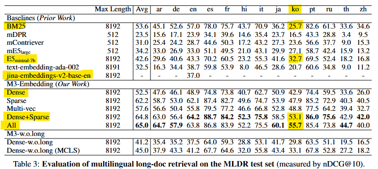
