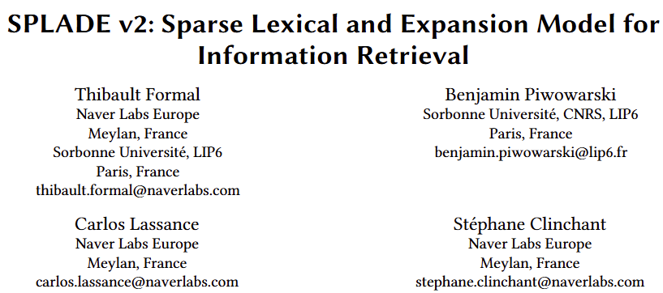
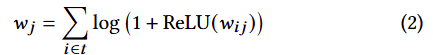
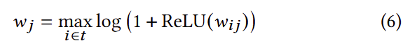
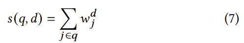
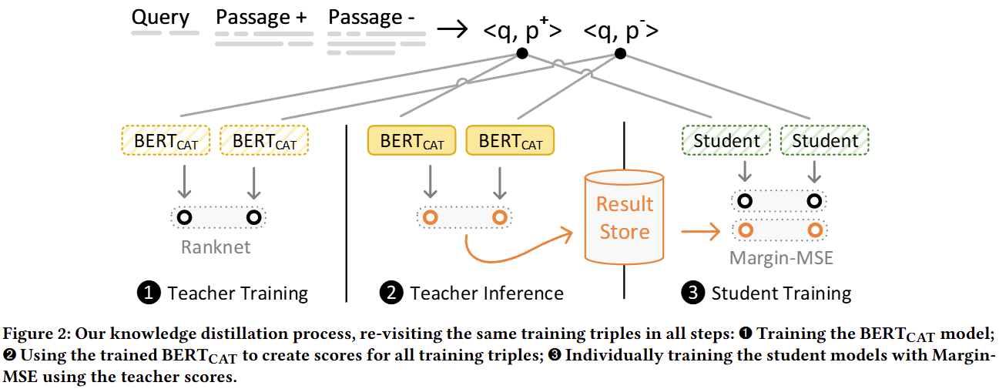
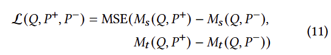
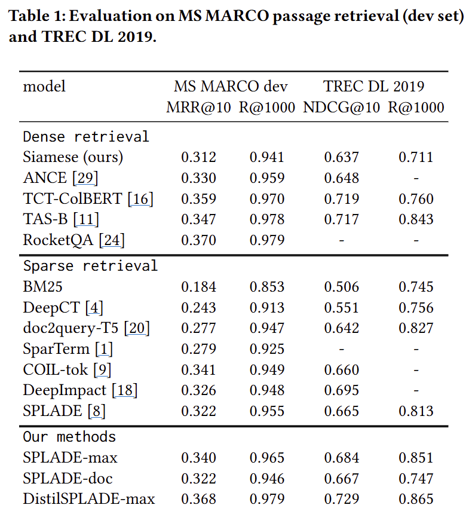

## SPLADE 모델의 개선

- 기존의 Log-saturation
    
- SPLADE-max
    - Pooling 전략
        
    - max_pooling으로 변경
- SPLADE-doc
    
    - 문서 전용 버전의 인코더
    - Query와 Document에 공통으로 존재하는 Document Term의 Weight만을 모두 더함
    - → Document Term Weight를 미리 계산해 놓기 때문에, Inference cost가 최소화
- DistilSPLADE-max
    - 2단계의 학습과정
        - Distillation과 Hard Negatives 반영
    - 1단계) distillation 기반 학습
        - SPLADE first-stage retriever와 cross-encoder ranker를 학습
            - Teacher : [http://huggingface.co/cross-encoder/ms-marco-MiniLM-L-12-v2](http://huggingface.co/cross-encoder/ms-marco-MiniLM-L-12-v2)
            - [12]에서 생성한 triplet (Query, Passage+, Passage-) 이용
            - [12] Improving Efficient Neural Ranking Models with Cross-Architecture Knowledge Distillation
                
                - Loss함수
                    
    - 2단계) DistilSPLADE-max
        1. hard negatives 데이터 생성
            - 1단계 학습결과 이용
            - Margin-MSE loss 사용
                - Margin개념을 포함한 MSE Loss
                - 하나의 문서쌍 간 점수 차이를 일정 마진 이상으로 유지하도록 모델을 학습
        2. SPLADE model를 1단계부터 재학습

## Experimental setting and Results

- 데이터셋
    - MS MARCO passage ranking 데이터셋
        - querys : 수십만 개
        - passages : 약 880만개
        - 평균적으로 1.1개 passages / query
    - TREC DL 2019 데이터셋
        - 43개의 Human Labeled Query세트
- 비교실험
    
