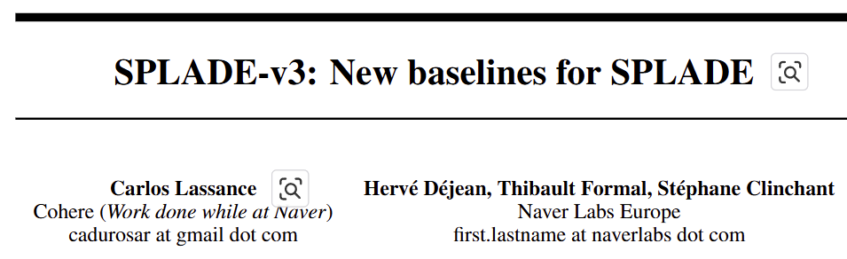
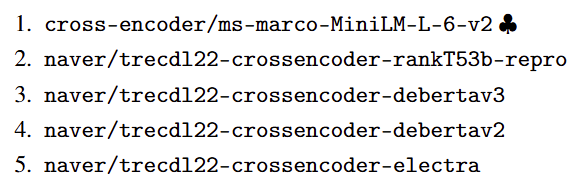
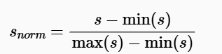
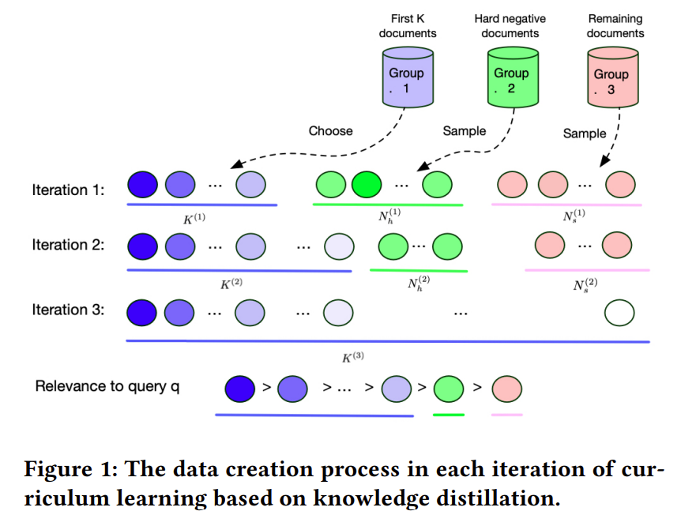
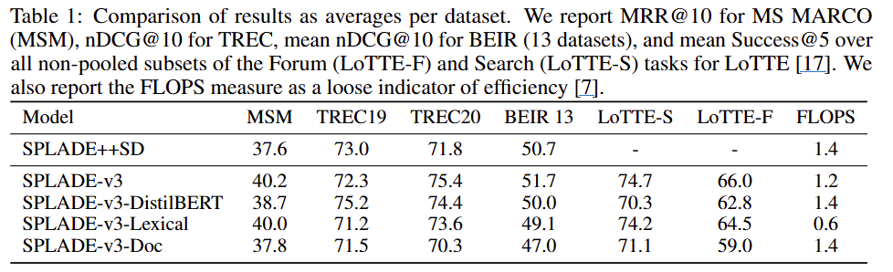
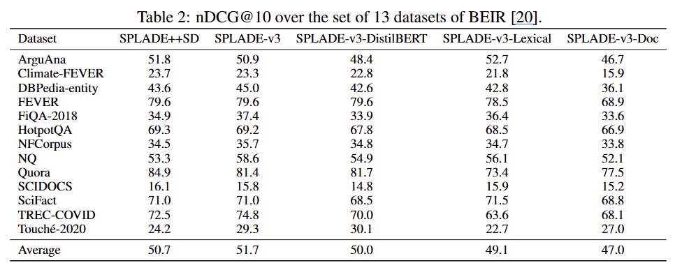

## Better Training

- Multiple Negatives Per Batch
    - SPLADE++ (SPLADE v2) 이용
    - MS MARCO 학습셋
        - 50만개 Query 별로
        - hard negative 100개 선정 : 상위 50개와 상위 1k중 50개 임의선정
- Better Distillation Scores
    - 2가지 타입의 앙상블 score 사용
        1. simple ensemble score
        2. re-scored 버전 : 평균과 분산값 기준으로 정규화한 ensemble score
    - re-rankers (score생성모델)
        
    - simple ensemble score계산
        - re-rankers에 입력하여 정규화된 score 값 계산
        - min-max aggregation
            
    - re-scored 버전 계산
        - simple ensemble score의 통계치(평균, 표준편차)를 조사
        - 첫번째 re-ranker모델과 유사하도록 affine변환 (선형변환) 수행
        - 경험적으로 변환을 하는 것이 도움이 되는 것 같다고 함
- Two Distillation Losses
    - 두가지 Distillation Loss를 선형 결합하는 것이 좋은 결과를 얻음
        1. KL-Div Loss: 람다값 1
        2. MarginMSE Loss : 람다값 0.05
    - cross-validation 통해 적절한 람다값을 선택함
- Futher Fine-tuning SPLADE
    - curriculum learning을 이용하여 이전 보다 향상된 결과를 얻을 수 있음
        
    - [21] Curriculum Learning for Dense Retrieval Distillation

## SPLADE-v3

- 3가지의 다른 SPLADE-v3를 배포함
    1. SPLADE-v3-DistilBERT
        - model
            - naver/splade-v3-distilbert
        - DistilBERT기반의 더 작은 메모리 차지하는 추론용
    2. SPLADE-v3-Lexical
        - model
            - naver/splade-v3-lexical
        - query expansion 기능 없는, 검색 계산 효율성 버전
    3. SPLADE-v3-Doc
        - model
            - naver/splade-v3-doc
        - CoCondenser : triplet 이용 knowledge distillation 기반의 학습
        - document-only 인코딩

## Experiments

- 비교실험
    
    - 여러가지 벤치마크셋의 여러 지표로 실험하였을 때, SPLADE-v3의 성능이 대부분 좋은 성능을 보임
    - SPLADE++SD (SPLADE++SelfDistil)
    - 지표
        - MS MARCO (MSM)
            - MRR@10 (Mean Reciprocal Rank at 10)
                - 상위 10개에 대해, 정답 문서가 나타난 최초 순위의 역수
        - TREC, BEIR
            - nDCG@10 (Discounted Cumulative Gain at 10)
                - 상위 10개에 대해, 높은 순위에 더 큰 가중치 부여
        - 나머지
            - Success@5
                - 상위 5개에 대해, 모델이 반환한 문서들 중에서 성공적으로 찾은 문서의 비율
- 비교실험
    
    - 다양한 데이터셋 실험에서 SPLADE-v3가 가장 좋은 성능을 보임
