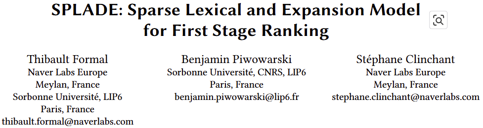

- git)
    - [https://huggingface.co/telepix/PIXIE-Splade-Preview](https://huggingface.co/telepix/PIXIE-Splade-Preview)
- article)
    - [https://zilliz.com/learn/bge-m3-and-splade-two-machine-learning-models-for-generating-sparse-embeddings](https://zilliz.com/learn/bge-m3-and-splade-two-machine-learning-models-for-generating-sparse-embeddings)

## SPLADE 모델의 기본 메커니즘

- SparTerm
    - 기반 기술
        - BERT WordPiece 토큰 (|V|=30,522) 사용
        - MLM (Masked LM) 기반 Token 학습
            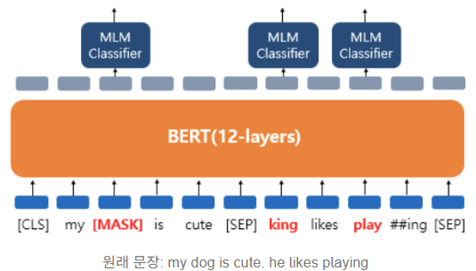
    - Term weight 계산
        1. 입력 Query와 Document 시퀀스의 Bert 임베딩의 행렬곱
            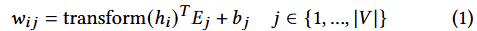
            - h_i = Token i의 bert 임베딩값
            - E_j = 시퀀스 내 타 Token들의 임베딩 행렬
            - transform () 함수 : Linear layer + GeLU + LayerNorm
            - b_j = Token 레벨의 bias
        2. Token_j의 weight 계산
            - 입력 Query (or Document) 내에서 해당 Term의 중요도를 Aggregation하여 계산
                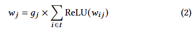
            - 해당 시퀀스에서 각 w_j의 활성화값을 모두 더 한 후, g_j와의 곱
            - ReLU (양수화)
            - g_j = binary mask (gating)
- Sparsity Regularization (희소성 정규화)
    - 불필요한 토큰들의 가중치를 0에 가깝게 조정
    - 관련없는 차원은 끄고, 유용한 차원을 활성화
    - 필요성
        1. 검색의 효율성과 속도 향상
            - 연산량과 저장량 최소화
            - 고속 검색 가능
        2. 과적합 방지 및 일반화 능력 개선
            - 핵심적인 단어에 가중치를 집중하도록 유도
            - 과적합 방지, 새로운 쿼리에 좋은 일반화 성능
    - g_j의 두가지 모드
        1. Lexical-only 모드
            1. BOW masking : 있으면 1, 없으면 0
        2. expansion-aware 모드
            1. binary gating 메커니즘 : g_j는 학습 가능 파라미터
            2. 원본 입력을 보존하려면, 1로 설정
            - gating 메커니즘 사용
            - end-to-end방식으로 훈련이 어렵고 별도의 훈련과정 필요
- SparTerm 학습위한 Loss함수
    - Loss함수
        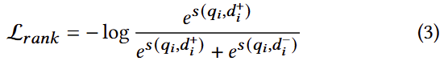
    - s(q, d)
        - query와 document의 ranking score
        - 두 벡터 간 내적 계산
    - 긍정문서셋 (Positive document = d^+)
    - 부정문서셋 (Negative document = d^-)
    - 손실 loss최소화 학습
        - 입력query가 긍정문서셋의 거리가 최소, 부정문서셋과의 거리가 최대화 되도록

## SPLADE 성능개선 위한 확장모델

- Logarithm activation (Log-saturation)
    - 특정 Term이 너무 큰 영향을 미치는 것을 방지하기 위해 식(2)를 개선
        
        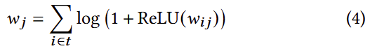
- Ranking loss
    
    - q_i = 입력 쿼리
    - d_i^+ = 입력 i에 대한 긍정문서
    - d_i^- = 입력 i에 대한 부정문서 (BM25 샘플링으로 가져옴)
        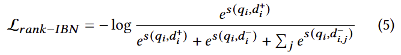
    - d_i,j^- = IBN (In-batch Negatives). 배치 내 다른 Negative 문서셋
- Sparse representation 학습
    - regularization
        - 모델이 과적합되지 않도록 손실함수에 특정한 규제함수를 더해서 손실함수값이 너무 작아지지 않도록 weight에 페널티를 주는 기법
    - Sparse정규화 위한 ‘L1 regularization’
        - L1 규제를 적용한 일반적인 비용함수
            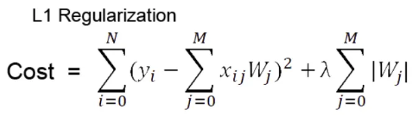
        - 비용함수를 편미분
            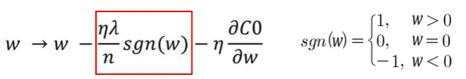
            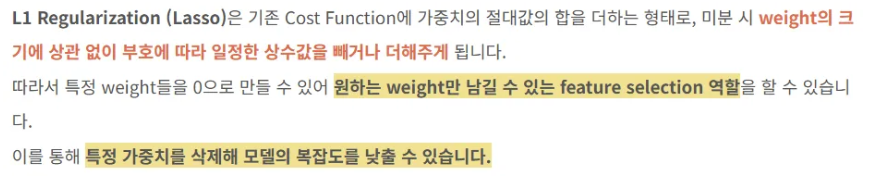
        - 특정 feature(차원)을 0으로 강제함으로써 효율적인 sparse representation 생성 가능
        - 문제점
            - Inverted Index Table의 불균일한 Posting list문제
                - 각 토큰을 포함하는 문서 리스트의 개수가 불균일
                - 비효율적인 인덱스 생성
                - 매우 빈번한 일부 단어들로 인해 불필요한 검색비용 상승
    - Sparse정규화 위한 ‘FLOPS regularizer’
        - 기대효과
            - Posting list 크기와 분포를 적절히 제어. 균형잡힌 Index생성
            - end-to-end 훈련
        - L_flops 계산
            - 입력 토큰별 0, 1 사이의 활성화 확률값을 규제값으로 사용하여 0에 가까워지도록 학습
            - 크기 N의 batch에서 문서 d에 대해 토큰 j의 평균 가중치
                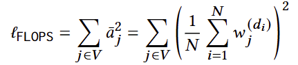
            - 0의 값이 완만하게 줄어드는 형태로 규제
            - 보다 균형적인 인덱스 테이블 생성하도록 함
        - 참고) Minimizing FLOPS to Learn Efficient Sparse Representations ([https://arxiv.org/pdf/2004.05665](https://arxiv.org/pdf/2004.05665))
- SPLADE : sparse, expansion-aware representation의 end-to-end training
    - 전체 Loss 계산
        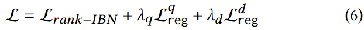
        - L_reg^q : Query의 sparse정규화 (L1 or L_flops)
        - L_reg^d : Document의 sparse정규화 (L1 or L_flops)
    - Query와 Document를 분리하여 규제
        - 빠른 질의검색 속도 위해 Document보다 Query의 중요한 Term에 더 많은 규제

## 실험

- 검색성능과 효율성 비교
    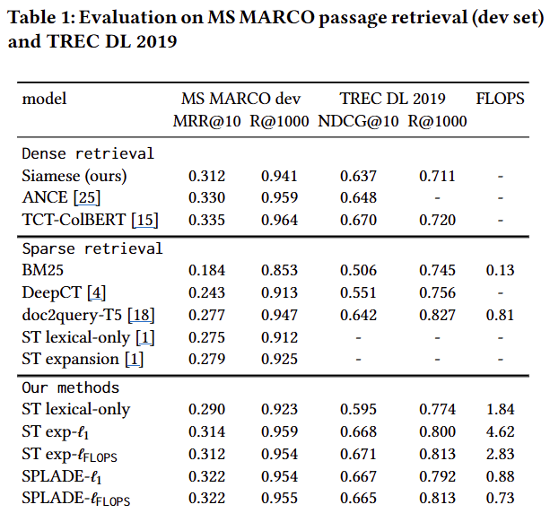
    - 데이터셋
        - MS MARCO dev
            - passage ranking dataset
            - 훈련셋 : 880만개 passage, 수십만 개의 질의어
            - 개발셋 : 6,980개 질의어
        - TREC DL 2019
            - 43개의 query집합 (사람 검수)
    - 지표
        - MRR (Mean Reciprocal Rank) : 평균 역순위. 높은 순위를 점수화
        - R : Recall, 재현율
        - NDCG : 추천시스템 성능평가 지표. 상위 랭킹에 높은 점수 부
    - model
        - ST : SparTerm (본 논문의 성능개선 모델 이전의 모델)
        - SPLADE  (본 논문의 성능개선 모델; end-to-end training)
    - Dense retrieval 모델은 상대적 높은 성능, but 효율성 제공하지 않아서 비교 힘듬
    - Sparse retrieval 모델은 효율성이 높으나, 성능이 낮음
    - SPLADE계열 모델은 dense 모델들과 경쟁력 있으면서, 높은 효율성 갖춤
- term expansion 실험
    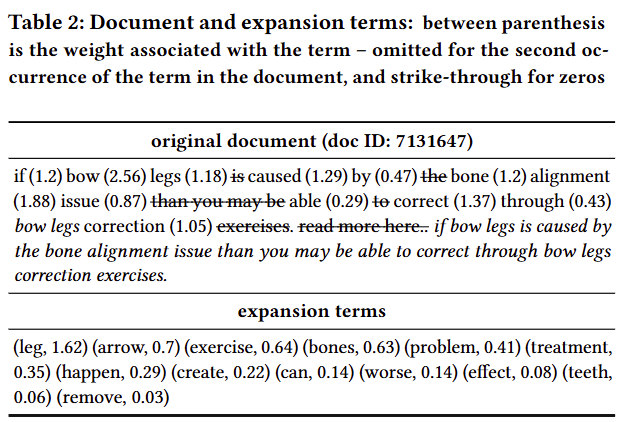
    - 관련없는 차원은 끄고, 유용한 차원을 활성화 하여 expansion과 compression의 균형을 맞춤
    - SPLADE-L_flops 모델 사용
    - 문서당 평균 20개의 term을 삭제하면서 32개의 expansion term을 추가
    - 중요한 term을 강조하고 정보가 없는 term은 삭제하여 term 재가중치를 수행
