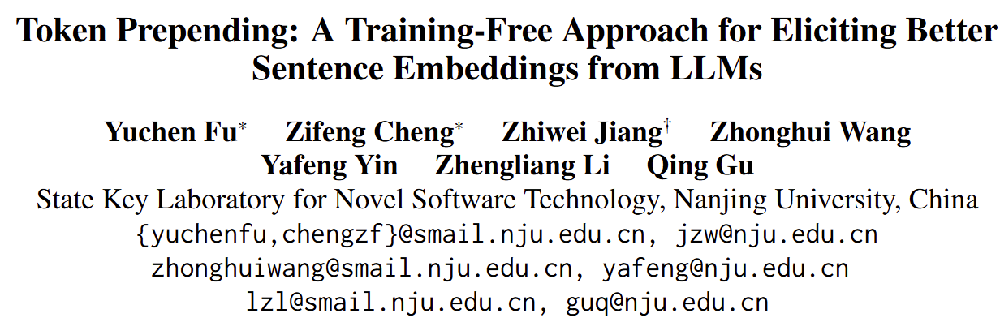
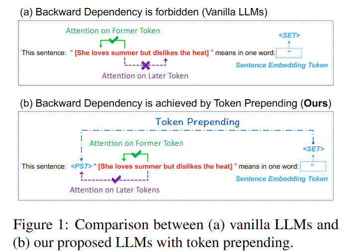
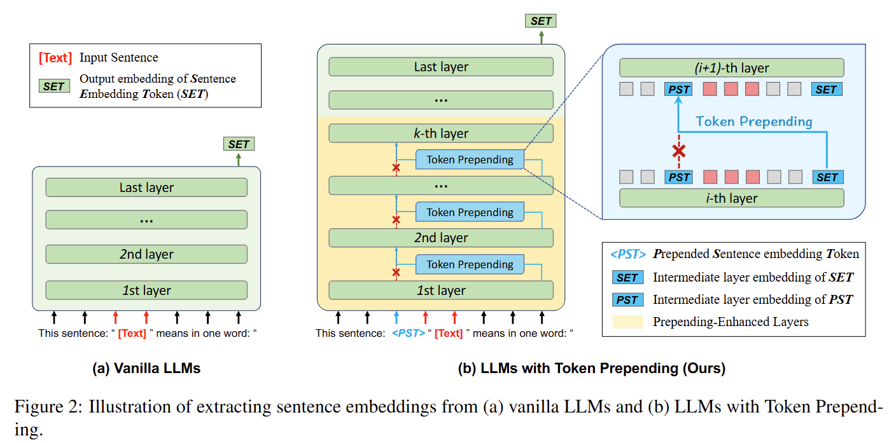
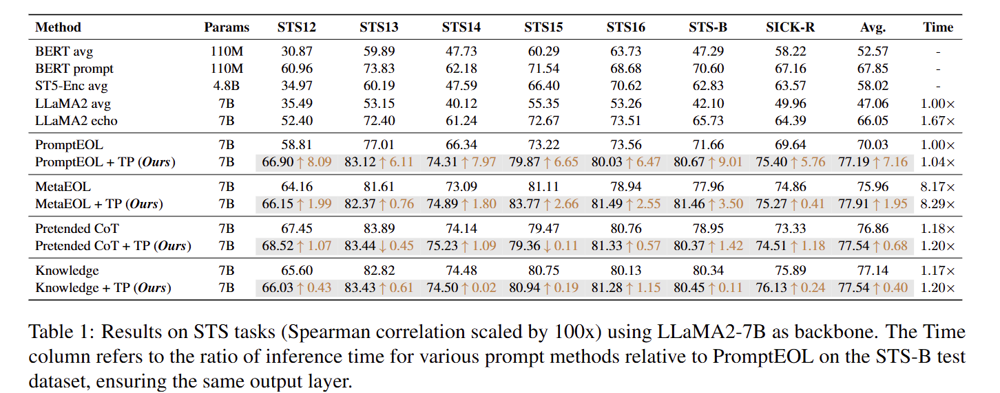

- 동기
    - 인과적 어텐션 사용하는 디코더 전용 모델에서 현재 토큰은 후방 토큰을 참조할 수 없기 때문에 편향된 인코딩과 최종 토큰에 연쇄효과가 발생
- 제안
    - 전방토큰이 후방토큰을 참조할 수 있도록 디코더 Layer별로 이전 Layer의 후방토큰 결과를 다음 Layer의 첫번째 토큰으로 입력하도록 하여 최종 토큰에 전체 문장 정보를 참조할 수 있도록 함
- 개념도
    
- 대표도
    
- 성능
    
