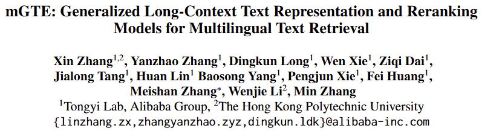
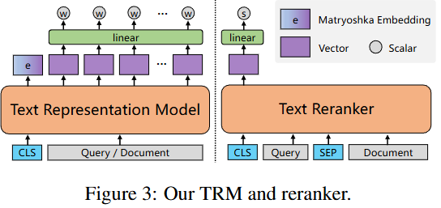
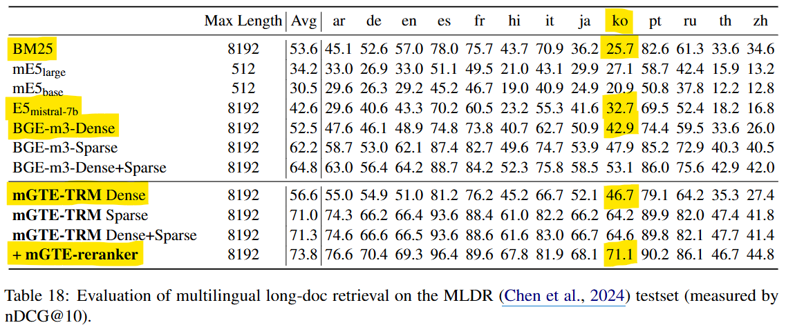
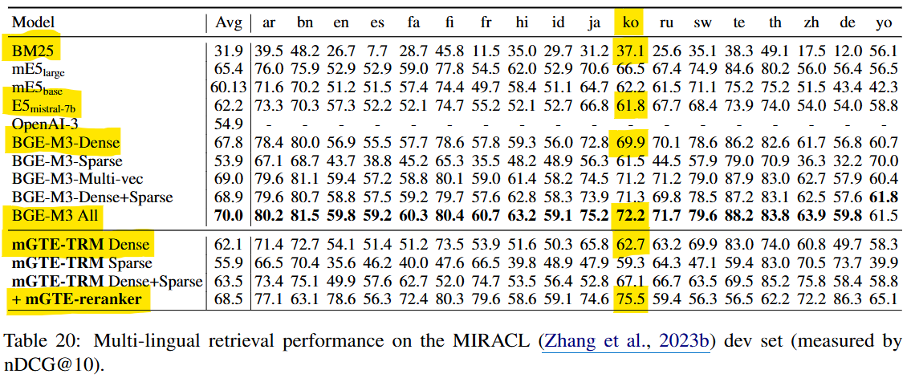
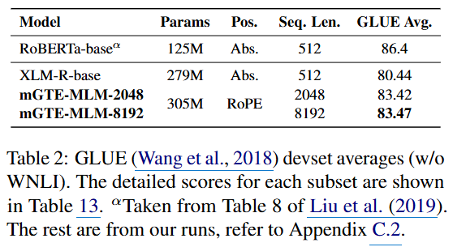
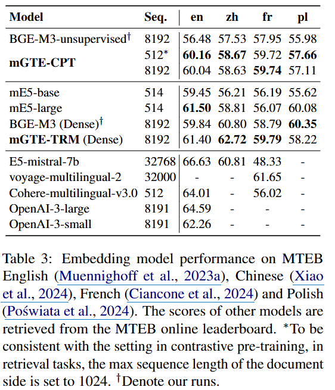

- 학습데이터 및 코드, 스크립트
    - 미공개
- 공개된 모델만 사용가능
- TRM과 Reranker
    
    - TRM (Text Representation Model)
        - 위의 Text Encoder기반으로 Token Level 임베딩
    - reranking 모델
        - Relevance Score = [CLS] 출력 과 Linear Layer의 곱
        - Matryoshka Embedding
            - index storage saving과 search speedup을 위한 sub-vectors 변환

## Evaluation

- multilingual long-doc retrieval
    
- multilingual retrieval
    - MIRACL (A Multilingual Retrieval Dataset Covering 18 Diverse Languages) (2023)
        
- GLUE (General Language Understanding Evaluation)
    - 9개 Task로 구성
        - 참조) [https://wikidocs.net/253915](https://wikidocs.net/253915)
    - WNLI : 대명사 상호참조 데이터
        
- MTEB (Massive Text Embedding Benchmark)
    - 참조) https://blog.sionic.ai/custom-slug
        
