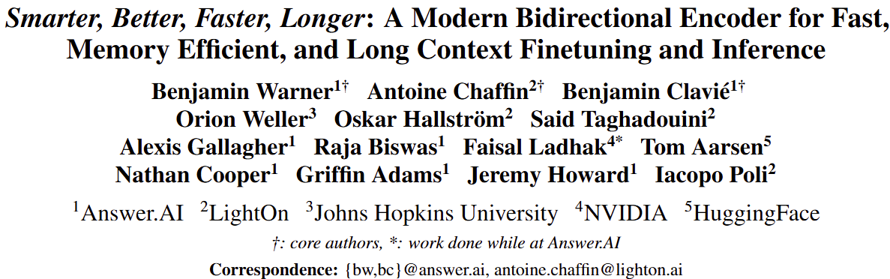
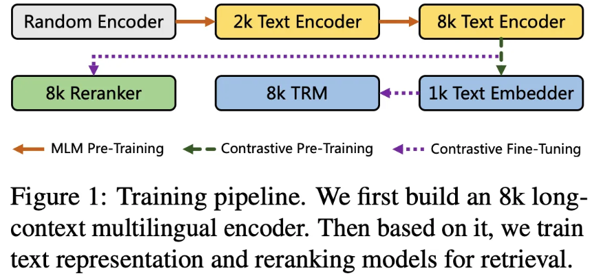
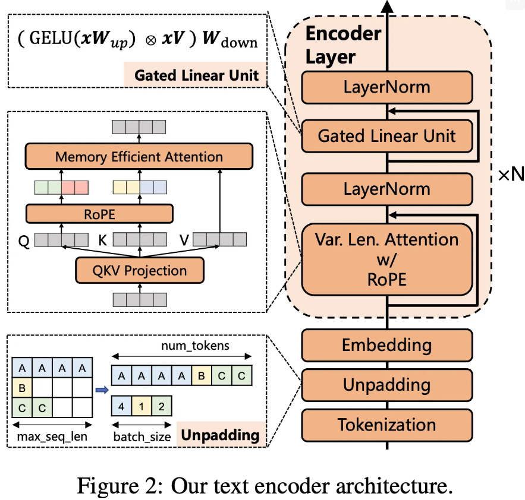
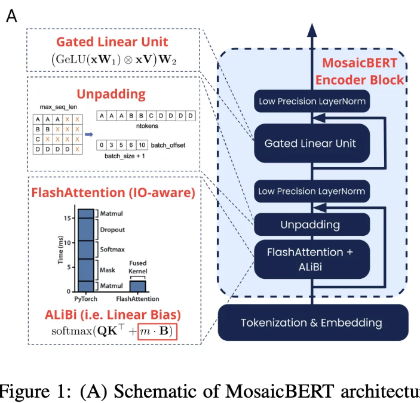
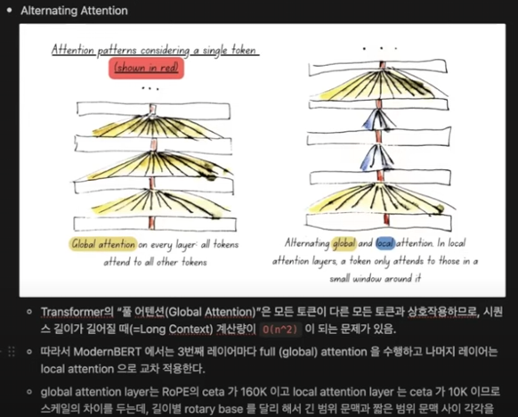
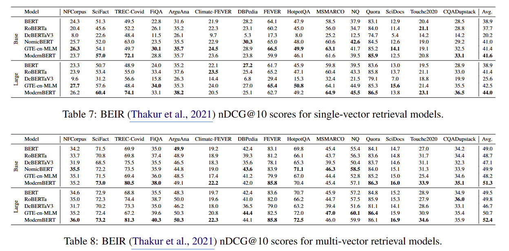
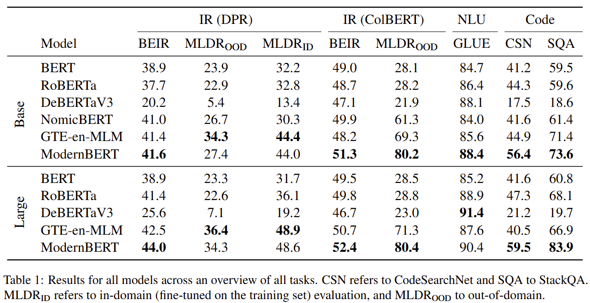
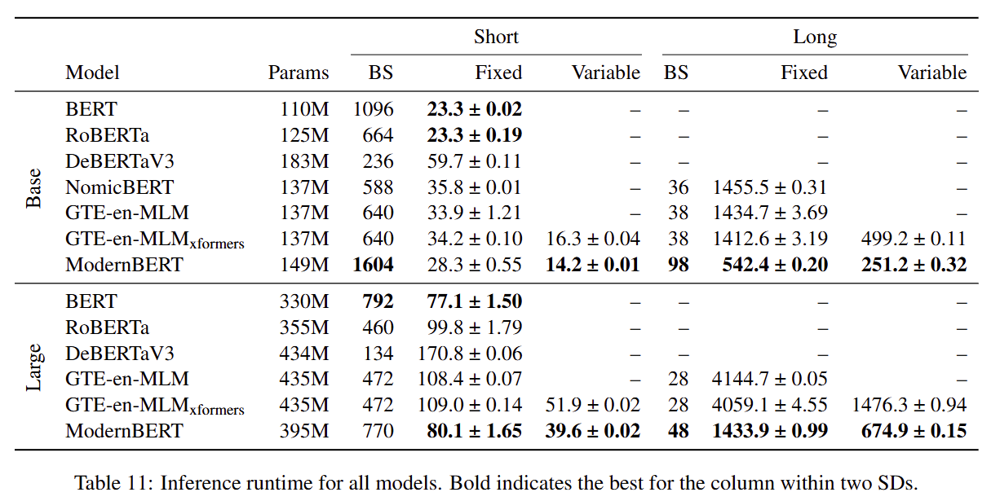
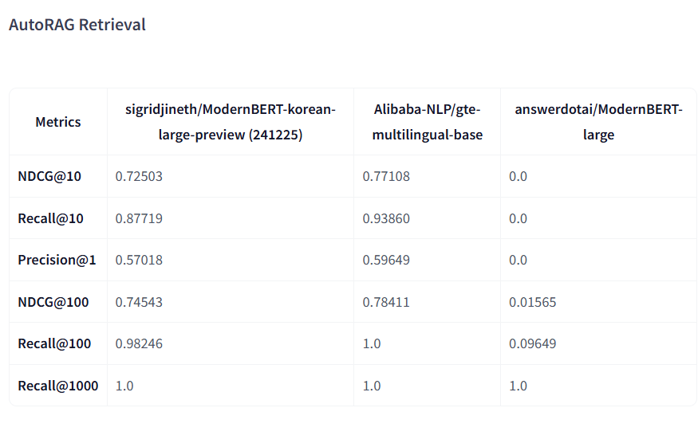

이 노트는 논문과 공개 세미나 영상을 함께 보고 정리했습니다. 발표자 의견은 세미나 당시의 평가입니다.

- 유튜브
    - https://www.youtube.com/watch?v=ovMGKHr8PqY
- huggingface
    - https://huggingface.co/answerdotai/ModernBERT-base
    - https://huggingface.co/answerdotai/ModernBERT-large
- Encoder모델을 아직도 현업에서 많이 사용하는 이유는?
    - LLM을 사용하기 쉽지 않아서
    - scale-out 어려움
- 2, 3B정도의 LLM을 쓰면 되지 않나?
    - 사용하기 애매함
    - 간단한 routing에 쓰기 어려움
    - 여전히 scale-out하기 어렵다고 생각됨
    - 2~3B 크기가 사용처가 애매함
- BERT류가 각광받는 이유는 가성비 측면
- 이전 5~6년전 BERT모델을 쓰기 아쉬운 점
    - context size 문제
    - RAG시스템의 긴 길이 입력에 제한
- GTE-en-MLM
    - Alibaba
    - (발표자들)
        - 굉장히 좋은 모델임
        - Encoder계의 QWen이라고 함
    - 코드 미공개
- BGE-M3
    - (발표자들)
        - 현재까지도 정말 많이 사용하는 현역
    - XLM-RoBERTa 기반 사전학습
    - 최대 8,192 토큰
    - 코드 공개
- ModernBERT
    - 코드가 다 공개되어 있음
        - 세미나 당시에는 개발 중인 코드였음
    - HuggingFace의 전폭적 지지
        - (⇒ 이후 Hugging Face에 공식 추가됨)
    - unpadding
    - packing : memory usage
    - batch 늘리기
    - gpu 덜 점유하기
- 주요 모델 정리
    - GTE (2024)
        - 성능이 retrieval 등 성능이 가장 높고, 다양한 benchmark에서 안정적 성능 보임
        - but, 모델 코드 및 훈련 script 미공개
        - 논문과 추론 위한 모델만 공개
        - multilingual 버전 공개됨
    - ModernBERT (2024.12)
        - 여러 benchmark에서 높은 성능을 보이긴 하나, 성능이 떨어지는 Task가 존재
        - Hugging Face에 공식 추가되어 모델 사용 가능
        - 모델 코드 공개
        - 훈련 script는 colbert script 등으로 가능한 듯
        - english버전만 있음
    - BGE (2024.2)
        - 많이 사용되는 모델
        - XLM-RoBERTa 기반
        - long context 지원 (8192)
        - 모델 코드 공개
        - multilingual 버전 공개됨

## 1. Introduction

- 주요 내용
    - MosaicBERT 코드베이스 기반. 23년 12월
    - FlashAttention 이용
    - GeGLU (adding a gate)
    - Unpadding
    - MLM 15% → 30%가 최적
    - vocab 64 정수배
    - MosaicBERT와 ModernBERT의 Motivation은 동일하다고 생각함
    - 2조 토큰 (2 trillion) 사전학습
    - 코드 데이터 포함
    - 더 긴 문맥 길이 (최대 8192)
    - 로컬-글로벌 attention 사용하여 메모리 효율적 사용
    - RoPE 적용
- Previous Works
    - multi-stage 학습 (다단계 학습)
        - 최근의 대세. 정석처럼 사용되고 있음
            - 1단계 MLM
            - 2단계 contrastive learing을 말하는 것 같음
        - 2단계에서
            - weakly paired data, 470M, 긍/부정쌍 만들기
            - small-sized contrastive learning, 235M. 인위적 라벨링된 고품질 데이터로 후처리
                - distillation 방식으로 negative 학습
                - BM25에 이용
                - cross-encoder에 이용
            - teacher distillation하는 방식을 많이 권장한다
                - teacher model에 BGE-M3
                - 양방향 인코더 사용
                - loss 함수에 negative + positive score를 이용
    - NomicBERT (2024.2)
        - RoPE
        - NTK interpolation
            - context 늘리기 위한 방안
            - [https://mari970.tistory.com/48](https://mari970.tistory.com/48)
            - [https://discuss.pytorch.kr/t/yarn-rope-llm-10-2-5-context-window-128k/2799](https://discuss.pytorch.kr/t/yarn-rope-llm-10-2-5-context-window-128k/2799)
        - GeLU → SwiGLU 교체 시도
            - 최근의 LLM이 사용하는 activation function이라서 따라가는 느낌이다
            - 라마류에서 사용되고 있음
            - 참고) [https://junhan-ai.tistory.com/271](https://junhan-ai.tistory.com/271)
        - Flash attention
        - Dropout = 0 → 안 하는 것이 좋다
        - vocab size를 64배수로 하는게 좋다
            - 메모리 효율적
        - grad cache가 필요한 이유
            - Unsupervised Contrastive Learning을 하려면 대규모의 데이터셋으로 해야 함
            - First Pairing 하기 어려움
            - False Positive가 많이 생성될 거임
            - 이걸 완화하는 방법은, large batch scaling을 하는 건데
            - memory 부족문제가 있으므로
            - grad caching을 할 수 밖에 없다
            - 결론
                - Unsup C/L : batch scaling이 중요
                - Sup C/L : False negative를 찾는 것이 중요 (→ hard negative 말하는 것임)
    - GTE-en-MLM (Alibaba)
        - 학습 코드 및 데이터 비공개
            - 추론 위한 모델만 공개
        - ModernBERT와 아키텍처 비슷하다
        - Encoder 백본으로 제시한 의미가 있다
        - base (12 layers), large (24 layers), RoPE, SwiGLU, attention dropout = 0, vocab size is multiply of 64, unpadding
        - 데이터: C4-en
        - training stage
            
        - MLM-512
            - lr = 2e-4, masking ratio 30%, bs = 4096, 300K steps
        - MLM-2048
            - lr = 5e-5, masking ratio 30%, bs = 4096, rope base = 10K, 30,000 steps
        - MLM-8192
            - lr = 5e-5, masking ratio 30%, bs = 1026, rope base = 160K, 30,000 steps
                
- MosaicBERT (Databricks)
    - FlashAttention, ALiBi, GLU (adding a gate), Unpadding, bfloat16 LN
    - MLM 30%, bfloat16, vocab multiplier 64, C4 ⇒ Pareto Optimality !
    - 전통적 BERT-Base가 같은 GLUE 점수(83.2)에 도달하는 데 약 11.5시간이 걸렸으나, MosaicBERT-Base는 4.6시간 만에 달성(약 **2.38배** 빠름).
        

## 2. Methods

### 2.1 Architectural Improvements

- Efficiency oriented modification
- GPU optimized model design

#### 2.1.1 Modern Transformer (성능에 관한 내용)

- Bias Terms
    - 메모리 절약을 위해
    - 비활성화
        1. 모든 linear layer의 bias term
        2. Layer Norm의 bias term
    - 활성화
        1. final decoder linear layer의 bias term은 그대로 둔다
- Positional Embedding
    - APE (Absolute PE) 대신 RoPE 사용
    - 긴/짧은 context에 성능 입증
- Normalization
    - 학습 안정성 위해
        - 표준 layer 정규화에 pre-normalization block 적용
        - pre-normalization (Xiong et al., 2020)
            - 입력데이터의 평균과 분산 조정
            - post-normalization보다 pre-normalization이 학습 안정성과 수렴속도 개선에 효과적
    - 그리고,
        - CrammingBERT와 같이, embedding layer 후에 LayerNorm 추가
        - 반복을 피하기 위해, 첫번째 attention layer안에 첫번째 LayerNorm을 제거
    - 파라미터 수가 커질 수록, MLP전에 LayerNorm적용하여 안정성 향상
- Activation
    - GeGLU (Gated-Linear Units)
        - MLP과정에서 gate를 통해 어떤 정보를 통과/차단할지 학습 → 표현력 개선효과

#### 2.1.2 Efficiency Improvements (성능 훼손 최소화, 연산 최적화에 관한 내용)

- Alternating Attention
    - 문제점
        - long context일 때, O(n^2)으로 증가
    - 방법
        - ModernBERT는 3번째 Layer마다 global attention을 적용하고 나머지 Layer들은 local attention
        - Local attention은 Sliding Window 사용
            
    - 구현
        - Global attention은 2개의 matrix의 inner product
        - Local attention은 일부의 column만 inner product
            - code에서는 masking을 사용하지 않고 slicing을 해서 구현한다
- Unpadding
    - GTE와 MosaicBERT과 동일한 방법 사용
        - 학습과 추론시 모두 적용
    - 문제점 : 기존의 Encoder-only model들
        - uniform한 sequence length 보장 위해 padding 토큰 사용 → 연산량 낭비 문제
        - 다른 Layer마다 unpad와 repad를 내부적으로 반복함으로써, 연산과 메모리 대역폭을 낭비
    - 개선 : ModernBERT의 Sequence Packing
        - 개념
            - padding 토큰 사용하지 않고, mini-batch내 모든 sequence를 이어 붙힘
        - 방법
            - Flash attention의 가변 길이 attention(과 RoPE) 을 사용
                - 들쭉날쭉한 attention mask와 RoPE 계산을 지원
            - 토큰 임베딩 이전의 입력을 unpadding 수행하고, 선택적으로 모델 출력을 repadding
                - (발표자 의견) global attention과 local attention 변환 사이에 unpadding, padding과정의 overhead 수행. 향후 Flash attention에서 지원되지 않을 까 얘기함
        - 다른 unpadding방법보다 10~20% 성능 향상됨
- Flash Attention
    - ModernBERT의 attention 연산을 위한 핵심요소라고 함
        - NVidia의 Flash Attention 지원에 의존하고 있음
    - global attention 기능 → Flash Attention 3 사용 (sliding window 미지원)
    - local attention 기능 → Flash Attention 2 사용
- torch.compile
    - PyTorch 2.x의 JIT (Just-in-time) 컴파일 통해 GPU최적화
        - Pytorch는 Tensorflow와 달리, 동적 그래프 사용
        - Pytorch의 중간 언어인 그래프 표현인 “Torch Script”로 변환
        - JIT 장점
            - Python 환경 및 버전에 비-의존성
            - 다른 환경에서 사용가능 : 다른 DL훈련도구, 서빙 플랫폼
            - 학습 및 추론 속도 향상 : 반복적인 연산(forward실행)을 기계어로 컴파일
    - compile overhead는 무시할 정도의, 10% 정도 추가 성능 달성

#### 2.1.3 Model Design

- 동일 파라미터 수, 다른 구조
    - 모델의 총 파라미터수가 같아도, 학습 특성이나 성능, 추론지연시간 측면에서 차이가 있음
        - Deep & Narrow : 레이어 수를 늘리고, 각 레이어의 hidden 크기를 줄이는 형태
        - Shallow & Wide : 레이어 수가 적고, 각 레이어의 크기를 늘리는 형태
    - Deep & Narrow의 장/단점
        - 장점 : 여러 연구에 따르면 downstream 성능 (fine-tuning결과 등)이 더 뛰어난 경향이 있음
            - Tay et al. 2022, Liu et al. 2024 등
        - 단점 : 레이어가 많아지면, 순차적 처리(시퀀셜)가 늘어나 추론 속도가 느려질 수 있음
- HW-aware 설계 필요성
    - HW 특성에 맞게 모델 크기/형상을 최적화하면, runtime 추론시간 등이 크게 단축된다고 함
    - 배수를 맞추면 CUDA tensor core가 효율적으로 동작한다는 것이 경험적으로 알려져 있음
        - Shoeybi et al. 2019, Karpathy 2023, Black et al. 2022
    - 최근에 굉장히 많은 관심을 받는 주제이다
        - 예를 들어, Tensor core tiling 관련하여
        - A100의 Tile 개수와 3090에 맞는 Tile개수가 다르듯이
        - 어떻게 Tiling하는 냐의 문제
- ModernBERT는 22 Layers와 28 Layers를 선택
    - 실행환경에 따라 모델 아키텍처가 최적으로 선택되어야
        - 예) 임베디드 시스템의 LLM 구조
    - 목표
        - Deep&Narrow가 주는 좋은 다운스트림 성능을 활용
        - GPU 효율 (tensor core tiling등)도 극대화
        - 추론 속도도 지나치게 느려지지 않도록 Layer수를 적당히 조절
    - 레이어 개수의 결정
        - ModernBERT-base : 22레이어, 약 149M 파라미터
        - ModernBERT-large : 28레이어, 약 395M 파라미터
        - Deep&Narrow 기조를 지키면서, 실제 HW상 크게 느려지지 않는 지점을 찾았다고 함
- Hidden size & GLU expansion
    - Base : hidden=768, GLU expansion=2,304 (→ hidden size의 3배)
    - Large : hidden = 1,024, GLU expansion=5,248 (→ 4,5배)
    - “Layer 내부 matrix가 64배수” or 전력 효율을 높일 수 있는 배수
        - 다양한 GPU에서 tensor core를 최적으로 활용하게 끔 한다
        - Nvidia CUDA 코어 연산은 “행렬 크기가 64 배수” 일 때 가장 효율적으로 동작함
            - (행, 열)이 64로 나누어 떨어지면 발휘되는 특화된 빠른 연산
        - (Tile Quantization)
            - weight matrix가 128 x 256 블록 단위로 나뉘어야, 즉 정렬/정규화 되어있어야 연산이 최적화된다. 행, 열 크기가 128, 256 등 특정 타일(block)으로 나뉘어 질수록 GPU에서 한번에 병렬화가 잘 됨
            - GPU별로 SM 개수가 다르기 때문에 워크로드를 균등하게 분배해야 최적화되어 동작한다

### 2.2 Training

#### 2.2.1 Data

- Mixture
    - 데이터의 자세한 사양은 공개하지 않음
    - 2조 (2 trillion) 토큰 규모의 다국어( 주로 영어) 데이터로 학습
    - 소스 : 웹 문서, 코드, 과학 논문 등, 최근 BERT가 일반적으로 사용하는 복합 데이터 mix
    - 최종 mix 비율은 여러 ablation 결과를 보고 결정
    - short는 512, long은 8,192 길이로 실험
    - code 얘기가 많이 나옴
        - 기존의 BERT가 다루지 않은 code retrieval 이 중요해서 일듯 함
- Tokenizer
    - OLMo 토크나이저 (2024)를 사용 → 코드 토큰 효율 및 성능 향상
        - OLMo 토크나이저 말고도 modern BPE 도 좋은 선택이 될 수 있다
        - 여러 개의 토크나이저로 실험해서 가장 좋은 것을 선정하여 사용함
        - 사전학습 코퍼스의 분포를 보고 선정
        - (⇒ 입력 특성에 맞는 토크나이저를 고려해서 선정 필요)
    - special token ( [CLS], [SEP] )과 템플릿은 기존 bert와 동일 → 호환성 유지
    - Dictionary 크기 = 50,368개
        - 64 배수 맞춤
        - 약 83개의 unused 토큰 남겨둠 → 향후 확장성 (ex, 태스크별 special token등)
- Sequence Packing
    - unpadding의 문제점
        - unpadding으로 인해 mini batch size가 들쭉날쭉할 수 있음
    - batch size크기를 균일하게 유지하기
        - Greedy 알고리즘 기반의 sequence packing (Raffel et al. 2020; Krell et al., 2022)
            - 작은 시퀀스들을 최대 길이 블록 안에 ‘꽉꽉’ 채우는 방식
            - 99% 이상 packing 효율 달성 → batch size 균일

#### 2.2.2 Training Settings

- MLM (Masked Language Modeling)
    - NSP
        - MosaicBERT처럼, NSP없이 MLM만 사용
        - NSP는 최근 연구통해 추가 이득이 미미한 것으로 알려줌 (2019, 2021)
        - 발표자들은 다음단계에서 Contrastive Learning을 하기 때문에 굳이 할 필요가 없다고 얘기함
            - (⇒ Sentence embedding 관점에 이렇게 생각하는 것 같음)
    - Masking Rate
        - 30%로 설정 (기존 BERT는 15% 사용)
        - Wetting et al (2023)에서 15%는 부족하다고 언급
- Optimizer : StableAdamW
    - StableAdamW = AdamW + Adafactor-style update clipping
        - Adafactor (Shazeer and Strn, 2018) 방식
        - per-parameter learning rate adjustment수행
        - 기존 AdamW보다 향상을 확실히 보임
        - 더 안정적인 학습과 일관된 downstream 성능을 제공
    - 기존 gradient clipping 대신 learning rate clipping (lr clipping)을 사용
        - 기존 gradient clipping은 일정 크기의 gradient를 일괄로 clipping
        - lr clipping은 각 파라미터 별로 update가 특정 범위를 넘지 않도록, lr을 동적으로 조정한다
- Learning Rate Schedule
    - Warmup-Stable-Decay (Trapezoidal)
    - Pre-training시 lr schedule을 수정
    - Warmup-Stable-Decay 사용 (Xing et al., 2018; Zhai et al., 2022; Hu et al., 2024) → 일반적 방식임
        1. Warmup : 초기에 LR을 천천히 키움
        2. Stable : 대부분의 학습단계에서 LR을 일정하게 유지
        3. Decay : 마지막에 짧게 LR을 감소
    - 장점
        - “언제든 체크포인트를 이어서 학습(continual training)할 때도 문제를 일으키지 않는다”
        - 성능도 cosine schedule과 대등하다고 알려짐 (Hagele et al., 2024)
    - ModernBERT-base
        - 학습토큰 = 1.7조 tokens
        - LR = 8e-4를 대부분 유지
        - warmup : 초기에 30억(=3x10^9) tokens warmup (LR천천히 상승)
        - 그 뒤에는 LR=8e-4로 고정
        - 마지막 짧은 구간에서 decay
    - ModernBERT-large
        - 학습토큰 = 900억 + 800억 = 1,700억 tokens (중간에 LR변경)
        - warmup : 초반 20억 (=2x10^9) tokens warmup후
        - LR=5e-4로 학습
        - 학습이 plateau (정체)하자,
        - LR=5e-5로 다시 시작해 800억 토큰 추가 훈련
- Batch Size Schedule
    - Batch size warmup
        - (1단계 pre-training 단계에서 사용)
        - 처음엔 작은 크기 → 점진적으로 늘림
        - 직관적으로 초기에는 모델 파라미터 상태가 좋지 않을 것이므로, 굳이 큰 batch로 업데이트는 비효율
    - 단계별 batch size 조정
        - 1단계 pre-training단계에서는 큰 batch size를 사용
            - batch size를 키우는 건 noise mitigation 목적이 있다
        - 2단계 contrastive learning단계에서는 작은 batch size를 사용
            - 1단계에서 파라미터들이 안정화됨
            - (⇒ 메모: Unsup을 위해서는 큰 batch size를 필요로 하는데 이거와는 어떠한 전략을 사용해야 하나?)
- Weight Initialization and Tiling
    - base모델의 경우, random init도 가능한데, large모델의 경우에는 base모델을 초기값으로 사용
    - ModernBERT-base
        - 방법
            - Nvidia의 Megatron Initialization 방법 사용
        - 상세
            - 랜덤값을 사용했더라도 distribution 값이 있을 것이다
            - scaling할 때에는 tiling기법을 사용
            - fan_in, fan_out은 Layer가중치의 행과 열의 크기를 나타내고, 파라미터 스케일링에 사용한다
            - 전형적인 초기화로 매우 작은 범위에서 무작위로 가중치를 시작한다
            - 149M 파라미터 이므로 랜덤으로 시작해도 안정적 이었음
    - ModernBERT-large
        - 방법
            - MS Phi 모델의 “center tiling” + Gopher Scaling 방법 사용
        - center tiling
            - 큰 모델 만들 때, 작은 모델의 파라미터 일부를 가져다가 center에 tiling한다
            - 작은 모델의 가중치를 중앙에 위치시키고, wrap-around해서 좌우 사각지대의 가중치를 자연스럽게 형성
            - ModernBERT-base weight 행렬 768 * 768을 가운데에 배치하고 그 보다 더 큰 부분, 예를 들어 1024 - 768 = 256 부분은 wrap around부분으로 base가중치의 일부를 복사해서 메꾼다
            - 참고) [https://secondspot.tistory.com/64](https://secondspot.tistory.com/64)
            - 참고) [https://junstar92.tistory.com/249](https://junstar92.tistory.com/249)
        - Gopher (Google Deepmind)
            - Gopher Family : 44M~7.1B모델
            - Gopher : 280B 모델
            - 참조) https://moon-walker.medium.com/%EB%A6%AC%EB%B7%B0-scaling-language-models-methods-analysis-insights-from-training-gopher-2cc1d07d12b9
        - Chinchilla (Google Deepmind) (2022.03)
            - 주어진 컴퓨터 자원에 적합한 토큰 수와 파라미터 수가 있다
            - 주어진 컴퓨터 예산을 모델 크기와 학습데이터 크기에 얼마나 할당해야 하는 지에 대한 실험을 진행해보니, 모델 사이즈/학습 데이터가 동등하게 scaling되어야 한다는 결과가 도출됨
            - 참고) https://learn-ai.tistory.com/entry/Paper-Review-Chinchilla-Training-Compute-Optimal-Large-Language-Models
        - layer확장
            - base모델의 Layer수 = 22개
            - large모델의 Layer수=28개
            - 중간 레이어의 파라미터를 특정 간격으로 interpolation해서 확장한다
- Context Length Extension
    - Base training
        - 1.7조 tokens, seq_len=1024, RoPE theta = 10,000
    - 추가 학습
        - 3000억 tokens, seq_len=8192로 확장
            - 특히, global attention Layer의 RoPE theta=160,000로 증가
        - LR=3e-4로 2500억 tokens, 이후 상위 품질 데이터샘플로 500억 token를 1-sqrt decay로 학습
        - 이 과정을 통해, 8k 길이 문맥에서도 잘 동작
            - 특히, IR/rerank-like retrieval에서 성능 손실없이 확장

## 3.Downstream Evaluation

### 3.1.2 Text Retrieval

- 평가 suite : BEIR (Thakur et al., 2021)
    - nDCG@10 성능을 측정
- Single Vector (DPR)
    - Dense Passage Retrieval : 문서를 하나의 벡터로만 표현
    - query & document : 동일한 차원 벡터로 임베딩
    - ranking : 코사인 유사도
    - 학습세팅
        - MS MARCO (2016) + hard negative (202)
            - 약 1.25M쌍, batch_size=16, warmup=5% of training
    - sentence-transformers (2019) 활용
- Multi Vector (ColBERT)
    - 문서 내 각 토큰 벡터를 유지
    - query와 document 유사도 계산 : MaxSim (쿼리 토큰별로 최대 코사인)
    - 학습세팅
        - JaColBERTv2.5 (Answer.ai; 2024) 레시피, batch=16, 5% lr warmup
        - MS MARCO 81만 샘플
        - KL-divergence distillation
            - teacher 모델 : BGE-M3 (2024)
    - ColBERT학습에 사용한 PyLate 라이브러리 (2024)로 학습을 수행함
- 결과
    - HotpotQA와 MS MARCO 결과가 BEIR의 주요 지표
    - 발표자 의견
        - 전반적으로 비슷하거나, 차이가 없거나, 비슷하거나
        - ModernBERT와 GTE가 큰 차이가 있다고 생각하지 않는다
        - 멀티벡터 쪽에서 더 점수에서 의미가 있을 거라고 생각
    - 다른 발표자 의견
        - 다른 곳에서 떨어진 성능을 TREC-Covid가 만회해줬다고 생각함 TT
        - TREC-Covid에서 20%이상 성능 향상은 비정상이라고 생각함
        - BEIR에서는 큰 성능 차이를 보인다고 보지 않는다
        - 오히려 성능이 떨어진다고 생각한다
            

### 3.1.3 Long-Context Text Retrieval

- 배경 및 평가 벤치마크
    - Code와 Long-Context는 ModernBERT에서 확실히 개선되었다
    - MLDR (2024)
        - 수십만 개의 long documents가 포함된 영어 대상 retrieval 벤치마크
            
- 결과
    - 실서비스에서는 GTE와 거의 차이가 없다
    - NLU에서는 DeBERTa가 말도 안되게 잘 나왔다
    - 기존의 BERT와 RoBERTa가 너무 잘 선방했다
    - ModernBERT가 기존 BERT를 개량한 것은 맞
    - 의미
        - BERT는 512에서 짜를 거다
        - Efficiency측면에서는 평가가 다를 거다
- (발표자) 추측
    - 긴 pretraining + local attention 시너지 → 토큰 단위 ColBERT와 궁합이 좋을 수 있음
    - (다른 발표자) 실용성에서 떨어질거 같다

### 4 Efficiency

- 유사 모델들에 비해서 batch size를 크게 키울 수 있고, Inference time이 빠르다
    
- GTE-en-MLM_xformers에 비해,
    - 더 큰 batch size를 넣을 수 있다
- 이 점들은 확실히 의미가 있다
    - 더 많은 메모리 사용가능

### 논문의 주장 (정리)

1. **ModernBERT가 장문에서 특히 빠른 이유**
    - (1) **Local attention**: 길이가 매우 커질수록, 전역(dense) attention에 비해 연산이 적게 든다.
    - (2) **Unpadding**: 실제 유효 토큰만 처리.
    - (3) **하드웨어 최적화 디자인**: hidden dimension·배수 설계 등으로 텐서 코어 효율.
2. **짧은 문맥(512 이하)에서도** 준수한 성능
    - 원조 BERT/RoBERTa는 파라미터가 더 적어서 어느 정도 이점을 갖지만, ModernBERT는 그 외 최신 대형 encoders보다 빠름.
3. **메모리 효율**
    - ModernBERT-base: 다른 모든 base 모델 대비 2배 이상 큰 배치 처리가 가능.
    - ModernBERT-large: BERT-base 수준 또는 그보다 더 나은 편. 나머지 모델들(DeBERTaV3, RoBERTa-large, GTE 등)보다 훨씬 여유로움.
4. **DeBERTaV3의 극단적 비효율**
    - 논문에서 언급하기를, DeBERTaV3는 GLUE 성능은 좋으나 **메모리 5~7배 더 사용** & 속도도 2배 느림.
    - “attention 구조”나 “disentangled matrix” 등 복잡한 부분이 원인으로 추정.

## 의견들

- MosaicBERT 기반에 RoPE를 추가
- ModernBERT를 HuggingFace가 지원하고 있고 이것이 HuggingFace에 정착될거 같다
    - 앞으로 지속 업데이트 될거 같다
- ModernBERT에 익숙해지는게 유리하겠지만, 코드를 조작하고 따라가기는 쉽지 않은거 같다
    - 그 이유는 MosaicBERT 코드를 가져와서 그렇다
- ModernBERT에 개선의 여지가 있다
- LLM 파인튜닝 Library ‘Composer’의 흔적이 ModernBERT에 남아 있다
- multilingual 버전이 아닌 english 버전이라서 그 위에서 바로 쓰기 애매하다

### Conclusion

- (발표자 총평)
    - ModernBERT를 지금 당장 어떻게 써보겠다 하는 것은 조금 쉽지 않을 수 있다
    - Long-context 인코딩을 위해서는 선택가능하지만 여전히 GTE가 이미 좋은 인코더 백본이다
    - BGE-M3 모델은 너무 좋은 모델이다
    - 그 보다 더 나아가서 distillation등을 하려면 GTE도 좋다. 그러나 다루기는 빡세다
    - 현재는 ModernBERT를 쓰기에 애매하다
    - [https://huggingface.co/sigridjineth/ModernBERT-korean-large-preview](https://huggingface.co/sigridjineth/ModernBERT-korean-large-preview)
        
