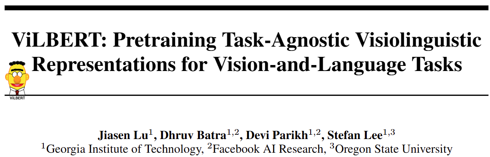
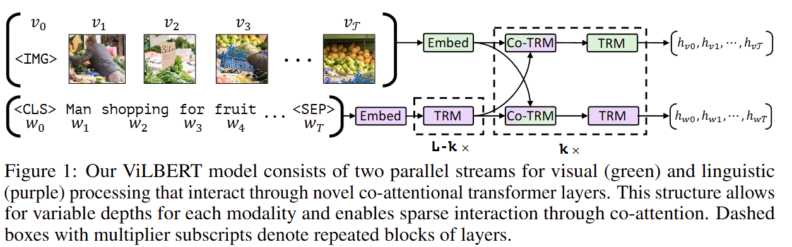
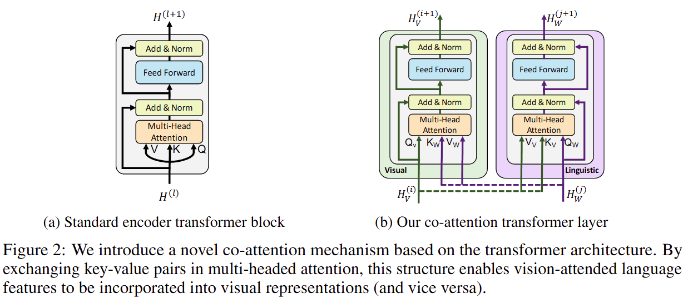
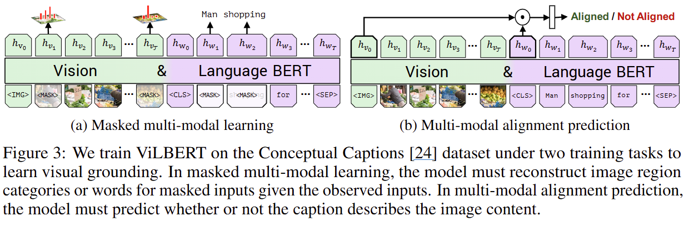
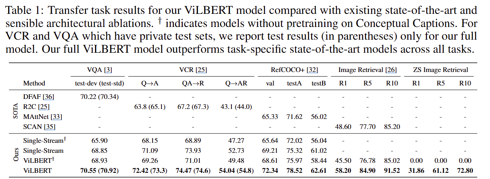

- github
    - [https://github.com/facebookresearch/vilbert-multi-task](https://github.com/facebookresearch/vilbert-multi-task)
- BERT 아키텍처를 multi-modal two-stream 모델로 확장
- co-attentional transformer layer

## 1 Introduction

- 모델이 완벽한 시각적 표현을 학습하더라도 ‘beagle’, ‘shepherd’와 같은 적절한 구문과 연결하지 못한다면 유용하지 못하다
- Proxy Task (대리 과제)
    - 대규모의 레이블이 없는 데이터를 활용하여 모델이 스스로 유의미한 표현을 학습할 수 있도록 만든 Self-supervised Learning의 한 형태
    - Text 분야에서는 MLM 과 NSP에 해당
    - ViLBERT에서는
        - 시각-언어 간의 의미적 연결관계를 pretraining
        1. Masked multi-modal modeling : 이미지와 텍스트 일부를 가려놓고 예측하기
        2. multi-modal alignment prediction : 이미지와 텍스트 쌍이 일치하는 지 예측하기
- Conceptual Captions 데이터셋
    - 330만개 이미지
    - 자동 수집된 이미지와 연관된 Caption
    - [https://github.com/google-research-datasets/conceptual-captions](https://github.com/google-research-datasets/conceptual-captions)
- 아래 4가지 task에 pre-trained 모델로 사용하여 SOTA 성능 달성
    - visual question answering [3]
    - visual commonsense reasoning [25]
    - referring expressions [2]
    - caption-based image retrieval [26]

## 2 Approach

### 2.2 ViLBERT : Extending BERT to Jointly Represent Images and Text

- BERT를 확장하여 언어 및 시각적 콘텐츠의 공통 표현을 학습
- 문제 제기
    - BERT구조를 최소한으로 변경
    - 이에 따른 문제점
        1. visual token 생성 문제
            1. visual input을 clustering 통해 discretizing (이산화) 하여 tokenize
            2. 이 과정에서 중요한 시각적 세부사항을 놓칠 가능
        2. 두 modality의 서로 다른 처리 Level 필요성
            1. 1) modality의 고유한 복잡성 2) 입력표현의 초기 추상화 수준
            2. 예를 들어
                1. 이미지 영역은 문장의 단어보다 관계가 약할 수 있다
                2. 시각적 특징은 종종 매우 깊은 네트워크의 출력이기도 하다
                3. 대규모 visual tokens을 pre-trained weights에 강제적으로 수용할 경우, 사전학습된 BERT 언어모델의 가중치가 훼손될 수 있다
- 제안하는 방식
    - two-stream 아키텍처
        - 각 modality를 개별적 모델링
        - 작은 범위의 attention-based interaction을 통해 fusing을 함
    - 기대효과
        - 각 modality별로 서로 다른 network 깊이가 가능
        - 서로 다른 깊이에서 cross-modal connection (교차 모달 연결)이 가능
- 대표도
    
    - 2개의 Parallel BERT-style 모델
        - image regions와 text segments에 대해서 동작
    - 각 Stream은 아래 구성요소들의 연속임
        - TRM (transformer block)
        - Co-TRM (co-attentional transformer Layer)
    - 두 stream간의 interaction은 특정 layer 간에서만 이루어짐
- TRM과 Co-TRM
    
- Co-Attentional Transformer Layers
    - Figure 2의 그림 (b)
    - 입력
        - 이전 Layer의 출력
        - H_v (이미지)
        - H_w (텍스트)
    - Q, K, V
        - Visual
            - Q : Image
            - K : Text
            - V : Text
        - Linguistic
            - Q : Text
            - K : Visual
            - V : Visual
- Image Representation
    - Special Token ‘IMG’
        - image sequence의 시작 토큰
        - 전체 image의 spatial encoding 한 것을 평균 풀링 (mean-pooling) 수행
- Training Tasks and Objectives
    
    - 2가지 pretraining 고려
    - masked multi-modal modeling
        - Figure 3의 (a)
        - 15% masking
        - Vision의 masked 영역의 예측
            - 예측분포) 해당 이미지 영역의 semantic class 분포를 예측
            - 정답분포) 사전학습 에서 사용한 detection model의 이미지 region에 대한 출력 분포를 사용
            - 위 두 분포의 kL-divergence minimization 학습
        - Language의 masked 토큰 예측
            - 기존 BERT와 동일
    - multi-modal alignment
        - Figure 3의 (b)
        - 2개의 표현
            - Vision : h_img
            - Language : h_cls
        - element-wise product
        - align여부를 binary 예측하도록 linear layer를 학습

## 3 Experimental Settings

### 3.2 Vision-and-Language Transfer Tasks

- Visual Question Answering (VQA)
    - Query : Image + Text 질문
    - Answer : Text 답변
- Visual Commonsense Reasoning (VCR)
    - QA : Q → A
    - (정답근거) Answer Justification : QA → R
- Grounding Referring Expressions (RefCOCO)
    - Query : Text 형식의 지시어
    - Answer : Image의 특정 영역
- Caption-Based Image Retrieval (Image Retrieval)
    - Query : Text 형식의 Caption
    - Answer : Image Pool에서 Image 검색

## 4 Results and Analysis

- Single-Stream
    - BERT구조 수정 없이 단일 BERT 아키텍쳐 사용
    - 두 modality가 매개변수 및 처리 stack 공유
    - 높은 계산 비용 초래
- 화살표 마크
    - Conceptual Captions 세트의 pre-training 하지 않음
