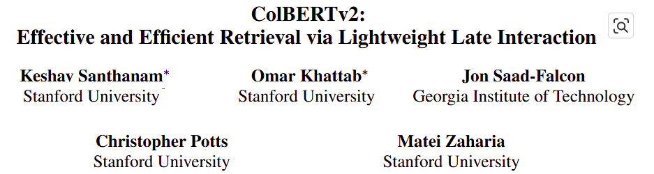
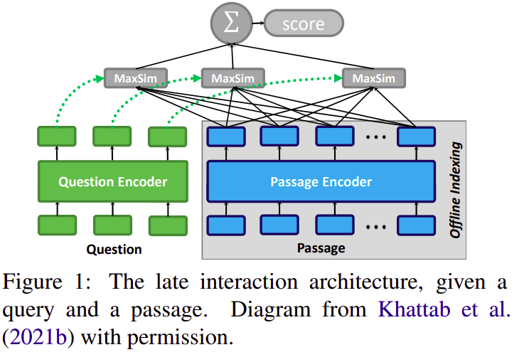
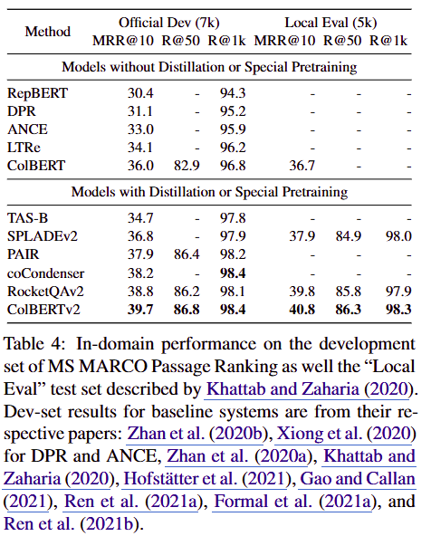

- 대표도
    

## 내용 요약

- Encoding
    - Bert기반 인코더 사용
    - 토큰 레벨 임베딩 표현 생성
    - Query Encoder : Special Token ‘[Q]’ 추가
    - Document Encoder : Special Token ‘[D]’ 추가
- Indexing
    1. Centroid Selection
        - Passage 집합 중 |C|개 만큼의 일부 Passage를 선정하여 Encoding
        - 전체 Passage를 Encoding하여 Centroid를 찾는 것은 저장공간 및 계산 비효율적임
    2. Passage Encoding
        - Passage입력, Bert 인코더 사용하여 토큰 레벨의 a bag of embedding 얻음
    3. Index Inversion
        - Inverted list 생성 : 개별 토큰 embedding to Passage 로 매핑
    4. Faiss Indexing
        - Facebook의 faiss library 사용
        - IVFPQ Index (product quantization이용한 index file)
            - Product Quantization
                - 고차원 벡터를 여러 개의 작은 벡터들로 Split
                - 분할된 개별 벡터들을 기정의된 Codebook의 ID로 인코딩
            - 하나의 Passage 는 여러 작은 토큰 벡터들로 구성
            - IVFPQ Index로 자연스럽게 색인 가능
- Retrieval
    - Faiss Retrieval 이용한 Nearest Neighbor 검색
        - Query 표현 Q에 가장 가까운 10개 centroids 검색
        - Centroid와 가장 가까운 토큰들 획득
    - top-k Passage 후보 검색
        - Inverted list를 이용하여 해당 Passage 임베딩을 식별
- Re-rank
    - Passage별 Score : MaxSim 계산
    - 순위 정렬
- 평가
    
