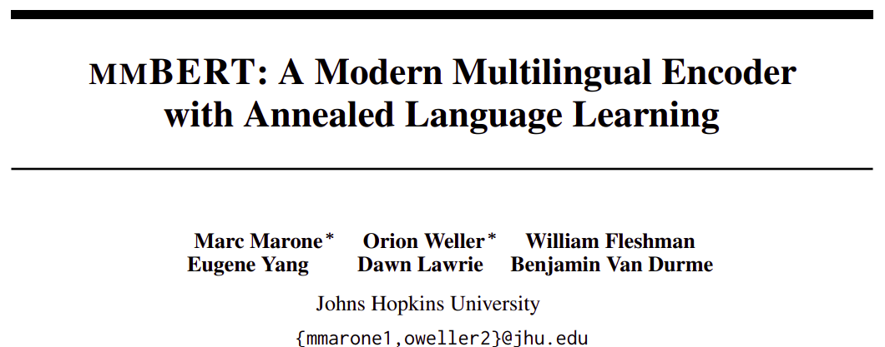
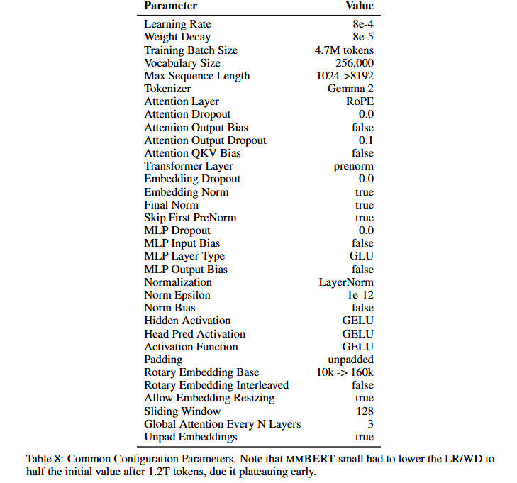
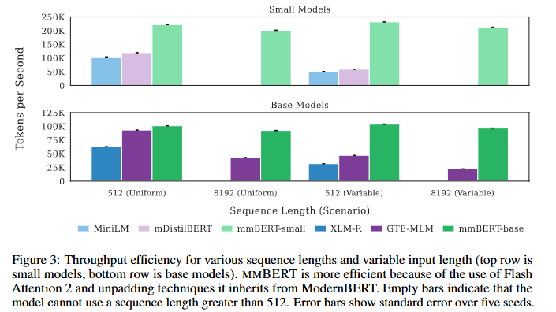
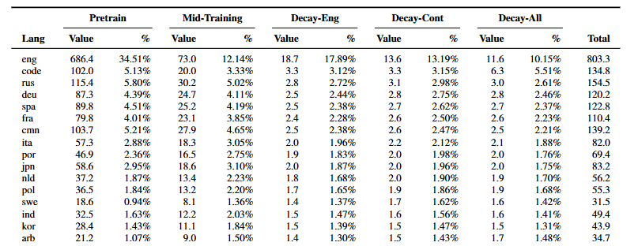
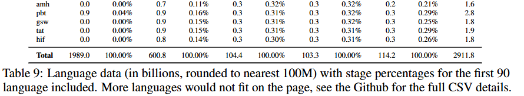
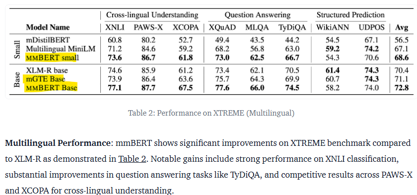
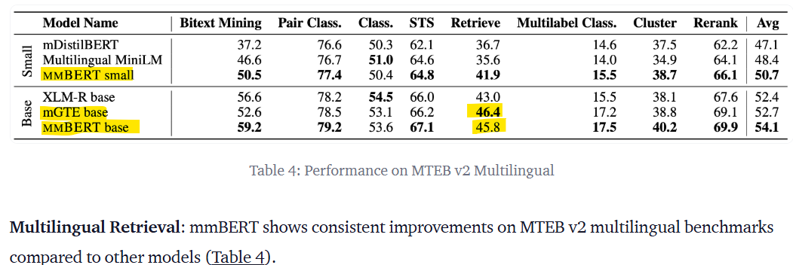

- huggingface
    - [https://huggingface.co/blog/mmbert](https://huggingface.co/blog/mmbert)
- multilingual : 1,833개 언어, 3T 이상 토큰 학습
- 다국어 입력 위한 Gemma2 Tokenizer1 (2024)
    - modernBERT는 OLMo Tokenizer (2024)
- Parameters
    - vocab size = 256k (modernBERT는 50k)
    - small
        - 22 개 Layer, intermediate dim 1152, hidden dim 384
        - 총 parameter 수 = 140M
    - base
        - 22 개 Layer, intermediate dim 1152, hidden dim 768
        - 총 parameter 수 = 307M
- Training
    - inverse mask schedule learning
        - pre-training의 scale에 비례해서 mask ratio를 점진적으로 줄여나감
        - 학습 순서
            - high lang to low lang
        - high resource language
            - 많은 양 학습
            - 높은 mask ratio
        - low resource language
            - 적은 양 학습
            - 낮은 mask ratio
    - Cascading Annealed language Learning
        - 기존 연구 : 고정된 언어집합과 temperature 사용
        - 학습 과정에서 new language 추가하면서 temperature 변경
            - 샘플링 분포 : high language에서 더 균일되게
    - 학습 단계별 언어 개수 증가 (60→110→1833)
        - high resource language → low resource language
- Architecture Details
    
- Compute
    - small : 8x H100 for 10 days
    - base : 8x H100 for 40 days
    - evaluation : 개별 실험별 1~2시간
- Throughput
    
- 언어별 비율
    
    

## 성능실험

- 참조) [https://huggingface.co/blog/mmbert](https://huggingface.co/blog/mmbert)
- Multilingual Natural Language Understanding
    
- Multilingual Retrieval Performance
    
