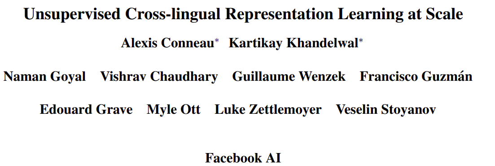
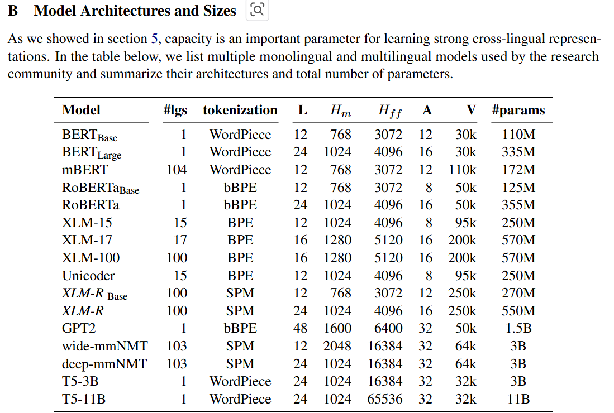
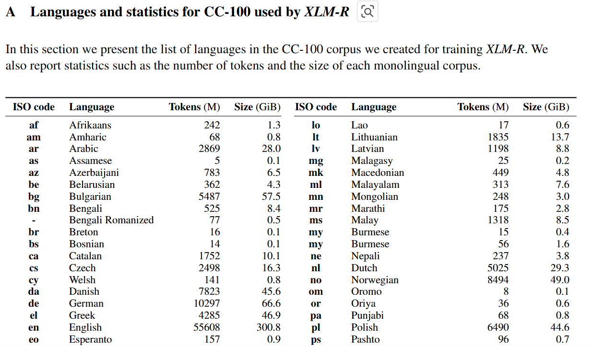
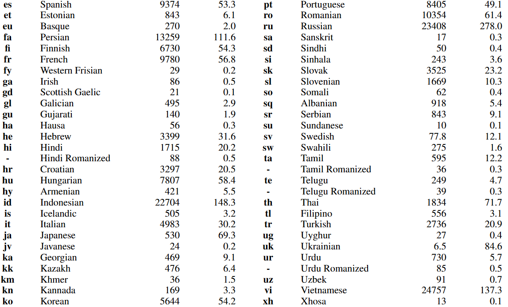
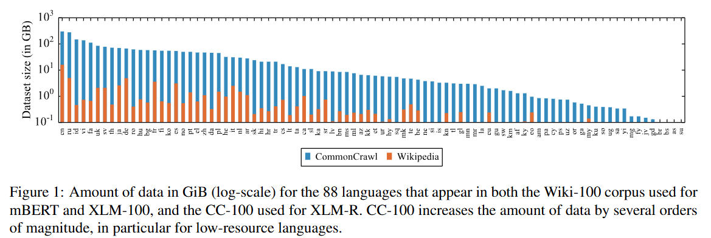
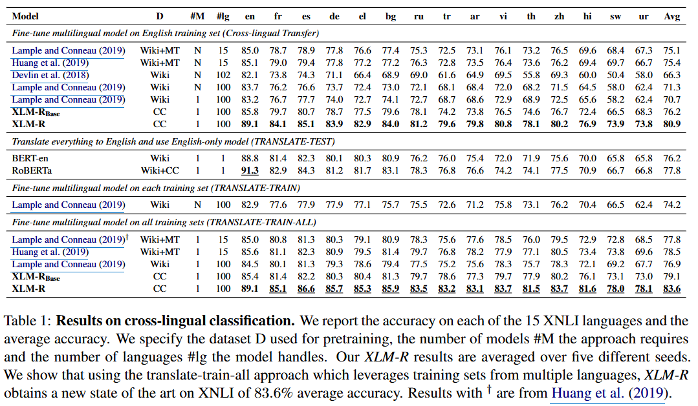
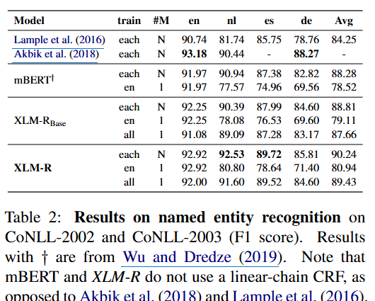
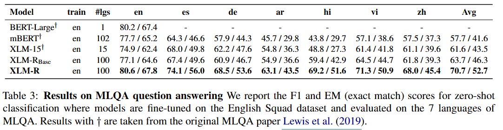

- huggingface
    - [https://huggingface.co/docs/transformers/model_doc/xlm-roberta](https://huggingface.co/docs/transformers/model_doc/xlm-roberta)
    - [https://huggingface.co/FacebookAI/xlm-roberta-base](https://huggingface.co/FacebookAI/xlm-roberta-base)
- Article
    - [https://dacon.io/competitions/official/235875/codeshare/4539](https://dacon.io/competitions/official/235875/codeshare/4539)
    - [https://nuevo-devo.tistory.com/31](https://nuevo-devo.tistory.com/31)
    - [https://ariz1623.tistory.com/309](https://ariz1623.tistory.com/309)
- 모델
    
- 데이터
    
    
- 언어별 비율
    

## Evaluation

- Cross-lingual classification
    
- NER
    
- Question Answering
    
